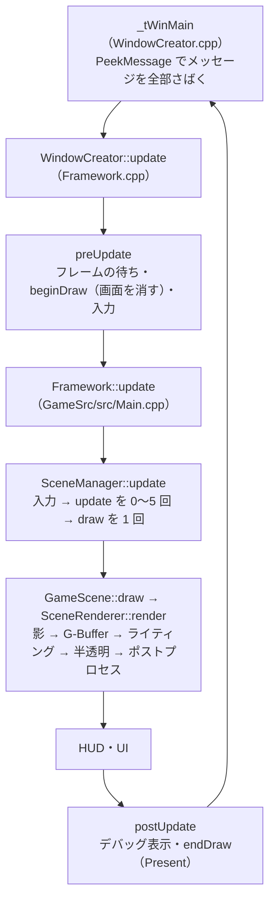

# 00 全体の地図

細かい所へ入る前に、「1 フレームの間に、どのファイルのどの関数が、どの順に呼ばれるか」を頭に入れる。
この地図が無いまま個々のファイルを読むと、「これはいつ呼ばれるのか」で毎回止まる。

## この章でできるようになること

- ウィンドウが出てから 1 フレームの絵が画面に出るまでを、関数の名前でたどれる
- GameLib・GameSrc/Render・それ以外、の 3 つの層の役割を言える
- GameLib の描画の関数が、D3D11 のどの API を呼んでいるかを引ける

## 3 つの層

| 層 | 場所 | 役割 | 学ぶ章 |
|---|---|---|---|
| 土台 | `GameLib/src/WindowCreator`・`GameLib/src/Graphics`・`Framework.cpp` | Win32 のウィンドウと D3D11 を包む。ゲームは D3D11 を直接呼ばず、ここを通す | 02〜05 |
| 描画の技法 | `GameSrc/src/Render`・`Resource/Shader` | メッシュ・スキニング・G-Buffer・ライト・影・ポストプロセス | 06〜09 |
| ゲーム | `GameSrc/src` のそれ以外 | シーン・世界・部品・当たり判定・ゾンビ・UI・音 | 01・10 |

DirectX11 を学ぶ、というときの中心は「土台」と「描画の技法」。
土台は D3D11 の API そのもの、描画の技法はその API を組み合わせた応用。

## 1 フレームの流れ

### 同じ流れを、ファイルと関数で

| 順 | ファイル | 関数 | していること |
|---|---|---|---|
| 1 | [WindowCreator.cpp](../LastDrop/GameLib/src/WindowCreator/WindowCreator.cpp) | `_tWinMain` | ウィンドウを作り、`while ( true )` で回り続ける。溜まったメッセージを `PeekMessage` で全部さばいてから `wc.update()` |
| 2 | [Framework.cpp](../LastDrop/Framework.cpp) | `WindowCreator::update` | 最小化中は寝る。そうでなければ `preUpdate` → `update` → `postUpdate` |
| 3 | 同上 | `Impl::preUpdate` | フレームレートの待ち → `Graphics::Manager().beginDraw()` → 入力の更新 |
| 4 | [Main.cpp](../LastDrop/GameSrc/src/Main.cpp) | `Framework::update` | 初回だけ `SceneManager` を始め、毎回 `SceneManager::instance().update()` |
| 5 | [SceneManager.cpp](../LastDrop/GameSrc/src/Scene/SceneManager.cpp) | `SceneManager::update` | `Pad` を読む → `mClock.ticksToRun()` の回数だけシーンの `update` → シーンの `draw` |
| 6 | [SceneRenderer.cpp](../LastDrop/GameSrc/src/Scene/Game/World/SceneRenderer.cpp) | `SceneRenderer::render` | 3D の絵を作る全部の段（下の表） |
| 7 | [Framework.cpp](../LastDrop/Framework.cpp) | `Impl::postUpdate` | 計測の表示・デバッグ文字・F6 のエディタ → `Graphics::Manager().endDraw()` |
| 8 | [ManagerImpl.h](../LastDrop/GameLib/src/Graphics/ManagerImpl.h) | `endDraw` | `mSwapChain->Present`。ここで初めて絵がモニターに出る |

### 3D の絵を作る段（`SceneRenderer::render` の中の順）

`SceneRenderer::render` は 150 行ほどで、このゲームの描画の全部の順番が書いてある。**一番先に読む価値のある関数。**

| 順 | 段 | 描く先 | 学ぶ章 |
|---|---|---|---|
| 1 | 影のマップ（懐中電灯 1 枚＋月の 3 枚） | 深度だけのテクスチャ | 09 |
| 2 | G-Buffer（動かない物 → デカール → 手元 → キャラ） | 色・法線・材質の 3 枚＋深度 | 06・07・08 |
| 3 | SSAO | 半分の大きさのテクスチャ | 09 |
| 4 | ライティング（全画面 1 回） | シーンの色（HDR） | 08 |
| 5 | SSR（Hi-Z を作る → たどる → 混ぜる） | シーンの色 | 09 |
| 6 | 霧 | シーンの色 | 09 |
| 7 | TAA | シーンの色 | 09 |
| 8 | 半透明の板（砂ぼこり・血・マズルフラッシュ） | シーンの色 | 05・08 |
| 9 | ブルーム → トーンマップ → FXAA（`PostProcess::endScene`） | バックバッファ | 09 |

## GameLib の関数と D3D11 の API の対応表

ゲーム側のコードは `Graphics::Manager` の関数を呼ぶ。中身は [ManagerImpl.h](../LastDrop/GameLib/src/Graphics/ManagerImpl.h) の同じ名前の関数。
公式ドキュメントやチュートリアルを読むときは、この表で「自分のコードのどれか」に読み替える。

| GameLib（`Graphics::Manager`） | D3D11 の API | 章 |
|---|---|---|
| コンストラクタ（`ManagerImpl`） | `D3D11CreateDeviceAndSwapChain` | 03 |
| `createRTVandDSV` | `IDXGISwapChain::GetBuffer`・`CreateRenderTargetView`・`CreateTexture2D`・`CreateDepthStencilView` | 03 |
| `beginDraw` | `ClearRenderTargetView`・`ClearDepthStencilView` | 03 |
| `endDraw` | `IDXGISwapChain::Present` | 03 |
| `setVertexBuffer` | `IASetVertexBuffers` | 03 |
| `setIndexBuffer` | `IASetIndexBuffer` | 06 |
| `setShader`（→ `applyShader`） | `IASetInputLayout`・`VSSetShader`・`PSSetShader` | 03 |
| `draw`・`drawIndexed`・`drawIndexedInstanced` | `Draw`・`DrawIndexed`・`DrawIndexedInstanced` | 03・06 |
| `setProjectionViewMatrix`・`setWorldMatrix`（→ `sendMatrices`・`flushConstantBuffers`） | `Map`・`Unmap`（定数バッファ b0） | 04 |
| `setConstantBuffer` | `VSSetConstantBuffers`・`PSSetConstantBuffers` | 04 |
| `setTexture`・`setNormalMap` | `PSSetShaderResources`（t0・t1） | 05 |
| `setShaderResource` | `PSSetShaderResources`（t2 から） | 08 |
| `setTextureFilter` | `PSSetSamplers`（s0） | 05 |
| `setBlendMode` | `OMSetBlendState` | 05 |
| `enableDepthTest`・`enableDepthWrite` | `OMSetDepthStencilState` | 05 |
| `setCullMode` | `RSSetState` | 05 |
| `setViewport` | `RSSetViewports` | 03 |
| `setRenderTargets`・`resetRenderTargets` | `OMSetRenderTargets` | 08 |
| `clear` | `ClearRenderTargetView`・`ClearDepthStencilView` | 08 |
| `drawFullScreen` | `IASetInputLayout( nullptr )`・`Draw( 3, 0 )` | 08 |

D3D11 の API の名前の頭の 2 文字は、パイプラインの段を表す（03 章）。
`IA` 入力アセンブラ・`VS` 頂点シェーダ・`RS` ラスタライザ・`PS` ピクセルシェーダ・`OM` 出力マージャ。

## 課題

### 課題 00-1：紙に描く

何も見ずに、上の「1 フレームの流れ」を紙に描く。描けなかった所を、コードを開いて確かめる。
次に `SceneRenderer::render` を上から読み、段の順番の表を自分で作り直す（上の表と合うか）。

### 課題 00-2：ブレークポイントでたどる

Debug ビルドで、次の 4 か所にブレークポイントを置いて実行し、呼び出し履歴（コールスタック）を見る。

- `ManagerImpl::beginDraw`
- `SceneManager::update`
- `SceneRenderer::render`
- `ManagerImpl::endDraw`

それぞれ「誰から呼ばれているか」を、コールスタックの上から下まで読む。上の表と同じ順に止まるはず。

### 課題 00-3：RenderDoc で 1 フレームを見る

RenderDoc でゲームを起動し、1 フレームをキャプチャする。イベントの一覧（Event Browser）を上から見て、
上の「3D の絵を作る段」のどれに当たるかを、描画先のテクスチャ（Texture Viewer）を見ながら書き込む。
今は全部分からなくてよい。08・09 章の後でもう一度やると、全部読めるようになっている。

## 説明できるか

1. 絵がモニターに出るのは、どの関数のどの API を呼んだ瞬間か
2. シーンの `update` と `draw` は、1 フレームに何回ずつ呼ばれるか。それを決めているのはどのクラスか
3. ゲーム側のコードが D3D11 を直接呼ばず `Graphics::Manager` を通すのは、何のためか
4. 「影のマップ」を G-Buffer より前に描くのはなぜか。「半透明の板」をライティングより後に描くのはなぜか（08・09 章の後で答えられればよい）
