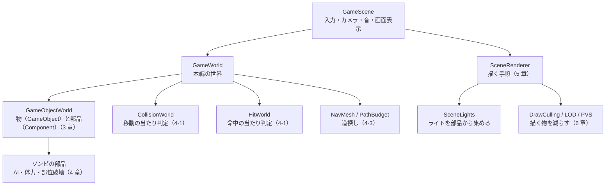
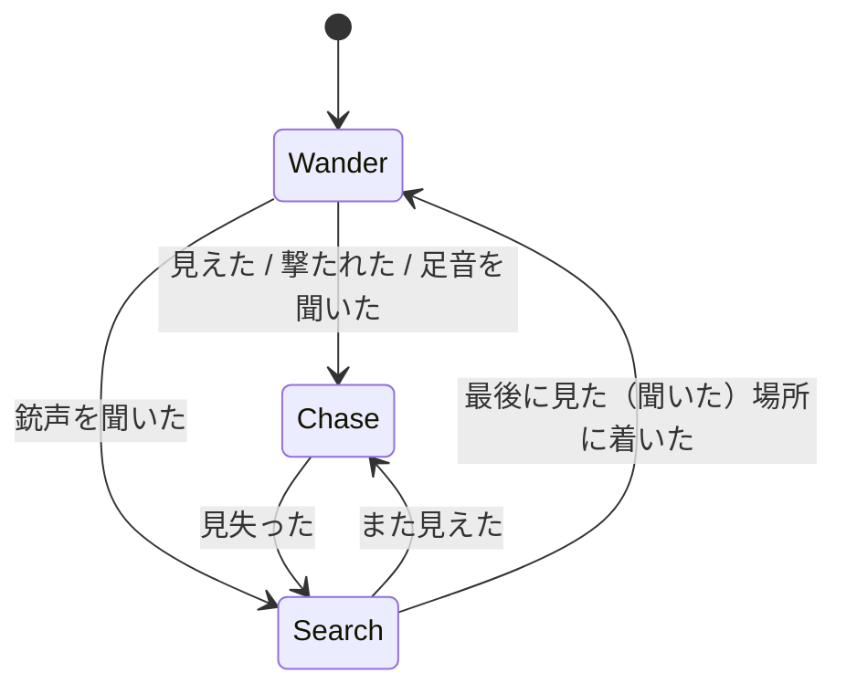

# LAST DROP 技術まとめ（ポートフォリオ用）

> **この資料の使い方**
> - 面接の前に読む、自分用のノート。4 つの分野（コンポーネント指向・敵の挙動・グラフィック・最適化）に絞ってある。
> - 各節は「何を作ったか → なぜその手法か → 工夫 → 数字 → 開くファイル → 説明の練習」の順。説明の練習は `Learning/` の章で、「説明できるか」に答えられた節から話に使う。
> - 数字の詳しい測り方と読み方は `計測の記録.md`（⑥ のような丸数字はその節の番号）。

---

## 1. 作品の概要

| 項目 | 内容 |
|---|---|
| タイトル | LAST DROP |
| ジャンル | 一人称のゾンビシューター（PvE・1 回勝負） |
| ゲームの流れ | 夜の町で箱を漁ってガソリンを見つけ、脱出の車に給油して、そばで耐えて脱出する（タイトル → 出撃 → 結果 → タイトル） |
| 言語・API | C++20 / DirectX11 / HLSL（ゲームエンジンは使っていない） |
| 借りたライブラリ | Recast／Detour（ナビメッシュと道探し）、miniaudio（音）、Dear ImGui（開発用のエディタ） |
| 開発期間 | 2026/05/30 〜（FPS としての本格開発は 2026/09 〜） |
| 規模 | ゲーム側（GameSrc）だけで 635 ファイル・約 45,600 行（2026/11/14）、シェーダ 43 本 |

### どこまでが自分の物か

面接では「どこまで自分で書いたの？」「AI は使った？」と必ず聞かれる。事実の通りに分けて言えるようにしておく。

**土台のライブラリ（GameLib）**：git の履歴から分かること（最初のコミット 2026/05/30 の時点で、DirectX11 で動いていた）

| 区分 | 中身 | 根拠（コミット） |
|---|---|---|
| 自分で追加 | 描画の基盤：Shader・ConstantBuffer・RenderTarget・DepthTarget・VertexFormat | 10/05「描画基盤の変更」 |
| 自分で追加 | GPU スキニング用の頂点（骨の番号・重み）、ノーマルマップのシェーダ | 09/21・10/05 |
| 自分で追加 | 計測の仕組み（`GameLib/Profiling`） | 10/25「GUI適応」 |
| 元からあった | 数学（Vector・Matrix）、コンテナ、ファイル読み書き、DirectX11 の描画の土台 | 最初のコミットに既にある |

> **自分で埋める**：GameLib を何から持ってきたか（本・授業・先輩など）。

**ゲーム側（GameSrc）**：4 つの分野ごとに、実際の通りに埋める。

| 分野 | 自分で決めた事（仕様・どの案を選んだか） | 自分で確かめた事（画面・計測） | AI に任せた事（実装） |
|---|---|---|---|
| コンポーネント指向 | | | |
| 敵の挙動 | | | |
| グラフィック | | | |
| 最適化 | | | |

> **自分で埋める**：面接での言い方。事実と違う言い方は、深く聞かれたときに一番弱い。
> AI を使わずに書いた物（`Learning/課題_ミニレンダラ.md` など）ができたら、ここに足す。

---

## 2. 4 つの分野の地図

| 分野 | 一言で | 一番強い数字 |
|---|---|---|
| コンポーネント指向（3 章） | 物は部品の組み合わせ。消えた物を指すバグを、構造で起きないようにした | 光る物・拾える物を足すとき、直すのは組み立てる所の 1 か所 |
| 敵の挙動（4 章） | 目的ごとに違う当たり判定、部位ごとの体力と部位破壊、ナビメッシュで回り込む AI | 移動の判定で比べた体 1,178 → 6（⑮） |
| グラフィック（5 章） | 夜の町のためのディファード＋PBR、影、SSAO・SSR・TAA | 2560×1369 で GPU 全体 約 1.5ms（⑫） |
| 最適化（6 章） | 回数を数える仕組みを先に作り、前後を比べて直す | 描いた回数 474 → 62、CPU の描画 −57%（⑭） |



世界（`GameWorld`）は入力・カメラ・画面表示を知らない。シーンが世界を読んで動かし、描く係（`SceneRenderer`）が世界を読んで描く。

---

## 3. コンポーネント指向

### 3-1. 物と部品（GameObject / Component / GameObjectWorld）

**何を作ったか**：Unity の GameObject＋Component と同じ考え方を、自前で持っている。物（`GameObject`）は「種類（タグ）・名前・付けた部品」を持つだけで、振る舞いとデータは部品（`Component`）が持つ。

```cpp
// 自キャラを組み立てる所（PlayerFactory::spawn。抜粋）
GameObject* obj = world->create( GameObjectTag::Player, kPlayerName );
obj->addComponent< TransformComponent >( position, yawDegree );
obj->addComponent< SkinnedModelComponent >( mPlayerData );
obj->addComponent< HoldComponent >( weapons );
obj->addComponent< PlayerHealthComponent >();
obj->addComponent< InventoryComponent >( startBag );
obj->addComponent< InteractorComponent >( kInteractReach );
obj->addComponent< PlayerComponent >();
world->spawn( obj );   // ここで全部の部品の awake → start が呼ばれ、動き始める
```

**なぜ部品か**：継承で種類を増やすと、「光る」「拾える」「撃てる」の組み合わせごとにクラスが要る。部品なら付け外しで済む。

**部品どうしの約束**

| 約束 | 中身 | ねらい |
|---|---|---|
| awake と start の 2 段 | `spawn` で、全部の部品の `awake`（自分の持ち物を作る）を済ませてから、全部の `start`（隣の部品の物を借りる）を呼ぶ | 部品を付ける順番を気にしなくてよい |
| 必須と任意 | 無いと成り立たない部品は `start` で `requireComponent` して覚える。無くてもよい部品は、使う所で毎回 `getComponent` して、無ければ飛ばす | 任意の部品は途中で外しても落ちない |
| 一緒にしか外せない | `requireComponent` された部品は、要った部品と一緒に外すときだけ外せる。片方だけ外すと ASSERT で止まる | 部品のまとまりを付け外しして、物の役割を変えられる |
| 世界に 1 つの物は棚から引く | 当たり判定の名簿・町の地面などは、世界が `provide` で棚に置き、部品が `shared< T >()` で引く | 部品を作るときの引数が増えない |
| 動く順番は段で決める | 部品は `UpdatePhase`（Input → Think → Late）のどれかに入り、`GameWorld::update` が段の順に呼ぶ | 「自キャラが動いた後にゾンビが追う」が、コードに見える |
| 種類は自前の番号 | 部品の種類は、型ごとに振った番号で見分ける（RTTI・`dynamic_cast` を使わない） | 同じ種類の部品を探すのが整数の比較で済む |

### 3-2. 物の寿命を構造で守る

**何が問題か**：ゲームでよくあるクラッシュは「消えた物を誰かが指している（ダングリングポインタ）」。これを、気を付けるのではなく、ルールで起きないようにした。

| ルール | 実装 |
|---|---|
| 持ち主は 1 人 | 物は `GameObjectWorld` が、部品は `GameObject` が `std::unique_ptr` で持つ。ほかは借りるだけの生ポインタ |
| 消すのはティックの最後だけ | `destroyLater()`・`removeComponentLater()` で印を付け、`flush()` でまとめて消す（遅延削除） |
| 物の寿命は物が決める | 死体・千切れた部位は、部品が自分で「消す印」を付ける。外の係が「消えたか」を毎回探さない |
| 名簿への登録と解除は 1 か所 | `IWorldMember::addTo / removeFrom`。どの名簿に何として載るかは、部品の側が知っている |
| 壊れる順番も設計 | 名簿（CollisionWorld・HitWorld）を物より先に宣言する＝物より後に破棄される |
| 消えたかを知りたい人 | ポインタではなく `GameObjectHandle`（番号）で持つ |

```cpp
// 千切れた部位の部品（SeveredLimbComponent::update）
mLimb.update( mGround );
if ( mLimb.isGone() ) {
    gameObject()->world()->destroyLater( gameObject() );  // 印だけ付ける（update の途中でも安全）
}
// ティックの最後に、GameWorld が mObjects.flush() を呼ぶ → 名簿から外して消える
```

### 3-3. 仕事を置く場所を 3 つに分ける

部品だけで全部を書くと、何体もまとめて扱う仕事の置き場所が無くなる。そこで、置く場所を先に決めてから書く（規約は `C:\AIResorce\GameDev\設計思想.md`）。

| 置く場所 | 置く仕事 | 例 |
|---|---|---|
| 物の部品（Component） | 1 つの物だけで完結する仕事 | ゾンビの体力・街灯の光・千切れた部位が自分で消える |
| 段の鎖 | 同じ物を、決まった順に書き換えていく仕事 | ゾンビのポーズの書き換え（のけぞり → 部位を消す → 這う。`BonePoseModifierChain`） |
| 係（普通のクラス） | 何体もまとめて扱う仕事、物ではない物 | ゾンビを湧かせる（`ZombieDirector`）・弾の当たりを解決する（`CombatResolver`）・描画 |

**部品にする・しないの線**：弾痕・砂ぼこり・血しぶきは、数が多くて 1 つが軽いので、物にせず `EffectManager` の中の並びで持つ。千切れた部位は「少なくて、重くて（ゾンビ 1 体ぶんのメッシュ）、自分の寿命を持つ」ので物にした。

### 3-4. インターフェースで依存の向きをそろえる

| インターフェース | 意味 | 実装する側 | 使う側 |
|---|---|---|---|
| `ICollisionBody` | 移動を止める体（真上から見た長方形） | キャラの当たり判定の部品・置物の箱の部品 | CollisionWorld |
| `IHittable` | 部位ごとに弾が当たる体 | `HitboxComponent` | HitWorld |
| `IDamageable` | ダメージを受けられる | `ZombieHealthComponent` | CombatResolver |
| `IRayBlocker` | 弾・視線を止める物（建物・地面・車） | `StaticModelComponent`・`TownGround` | HitWorld |
| `IWorldMember` | 名簿に自分を載せられる | 名簿に載る部品 | GameObjectWorld |
| `ILightSocket` | 光の出る所（位置と向き）を答える | `HoldComponent`（銃口） | LightComponent・MuzzleFlashComponent |

- 当たり判定の名簿は、相手がゾンビか建物かを知らない。種類を増やしても名簿のコードは変わらない（開放閉鎖の原則）。
- 銃の懐中電灯（`LightComponent`）は銃口の位置を知りたいが、知っているのは持つ側（`HoldComponent`）。直接知ると、銃の部品が自キャラの部品に依存する。`ILightSocket` を挟んで、光の部品は「光の出る所を答えてくれる誰か」だけを知る。

### 3-5. 「このデータは誰の物か」を見直した 5 つ

一度動く形にした後に、物の仕事なのに物の外の誰かが持っている所を、部品へ移した（遊び方は変えない作り直し）。

| 物 | 物の外が持っていた形 | 部品が持つ形 |
|---|---|---|
| 明かり | `SceneLights` が、懐中電灯・銃口・街灯を 3 通りの道で集めていた | `LightComponent` が自分の光を答え、`SceneLights` は部品を全部たどって集めるだけ |
| 銃 | 手に持つ銃と、落ちている銃が別の物 | 銃は 1 つの物。地面に置く間だけ、置き場所・見た目・箱・拾える部品のまとまりを付け、拾ったら外す |
| 持ち物 | `GameScene` が持ち、毎ティック引数で自キャラへ渡していた | 自キャラの `InventoryComponent` |
| 見ている物を使う | `GameScene` が持っていた | 自キャラの `InteractorComponent`。使える物を探す相手は棚から引く |
| 千切れた部位 | `EffectManager` の中の並びが、外から進めて、外から消していた | 1 つずつ物。`SeveredLimbComponent` が自分で落ちて、自分で消える |

**何が良くなったか**：`SceneLights` は「光る物の種類」を知らない。光る物を足しても、`SceneLights`・ライトの一覧・シェーダは直さない。

- **開くファイル**：`World/GameObject.h`・`World/Component.h`・`World/GameObjectWorld.cpp`・`Player/PlayerFactory.cpp`・`Zombie/ZombieFactory.cpp`
- **計画書**：`個別仕様/設計と分割/` の `ComponentSystem2_Plan.txt`・`ComponentSystem3_Plan.txt`・`LightComponent_Plan.txt`・`WeaponObject_Plan.txt`・`SeveredLimbObject_Plan.txt` ほか
- **説明の練習**：`Learning/10_ゲーム側の設計と当たり判定.md`

---

## 4. 敵の挙動

ゾンビは 1 体が部品の組み合わせ（状態・AI・追跡・攻撃・体力・這う・死体。`Zombie/Component/`）。生死の状態（Alive → Downed → Falling → Corpse → Sinking）と AI の状態を、別の部品に分けている。

### 4-1. 当たり判定：目的ごとに 3 つを使い分ける

移動の判定はゾンビだけでなく自キャラにも使っている（同じ `CharacterMover`）。

| 目的 | 形 | 手法 | なぜ |
|---|---|---|---|
| 移動 | 真上から見た回転した長方形（2D） | SAT＋掃引＋滑る移動 | 歩く移動は水平だけ。2D の方が軽く安定する。段差は地面に高さを聞いて合わせる |
| 建物の壁 | メッシュを体の高さで切り取った多角形 | Sutherland–Hodgman 法 | へこんだ入口や斜めの壁を、そのままの形で当てる |
| 命中 | 骨に付いた箱（OBB）と、建物の三角形 | スラブ法・Möller–Trumbore 法・BVH | 部位ごとのダメージに、部位ごとの箱が要る |

**移動：SAT＋掃引＋滑る移動**（`Collision/SweepMath.cpp`・`Collision/CharacterMover.cpp`）
1. **SAT**：2 つの形を、それぞれの辺の向き（軸）へ影として落とす。1 本でも影が離れていれば当たっていない。
2. **掃引**：軸ごとに「影が重なり始める時刻・離れる時刻」を求め、全部の軸で重なる一番早い時刻が当たった瞬間。速く動いてもすり抜けない。
3. **滑る移動（Collide-and-Slide）**：当たったら面の少し手前まで進み、残りの移動から面へ向かう成分を消して壁に沿って滑らせる（最大 3 回）。

- 面のちょうど上で止めると、誤差で次の判定が壁の内側から始まる。なので 1mm 手前で止める（Unity の skinWidth と同じ考え）。
- 入り隅（2 枚の壁の角）で左右に振動しないよう、前の面に入り込む向きになったら止める。
- 群れに囲まれてめり込んだら、一番浅い軸の向きへ押し出す。

**建物の壁**（`Collision/MeshWallBuilder.cpp`）：建物の三角形を、体の高さの範囲（0.3m〜1.8m）だけ切り取って壁のかけらにする。足元の歩道の板や頭より上の庇は移動をふさがない。同じ向きの辺の法線は 1 本にまとめ、SAT で調べる軸を減らす。

**命中**（`Hit/HitMath.cpp`・`Hit/TriangleBvh.cpp`）
- **弾は毎ティック「線分」で調べる**：弾速 830m/秒で 1 ティック約 14m 進むが、通り道全体を線分で調べるのですり抜けない。
- **部位の箱はスラブ法**：箱を「-1〜1 の立方体を置く行列」で持ち、逆行列で線分を立方体の空間へ移す。どんな向き・大きさの箱でも同じ計算で済む。法線を戻すときは (M⁻¹)ᵀ を使う（拡大の入った行列で、ただの M だと法線が曲がる）。
- **建物は Möller–Trumbore 法**：三角形の中の点（u, v）と線分上の点（t）を連立で解く。
- **三角形は BVH で絞る**：三角形を箱の木にまとめ、線分が当たらない箱の中は調べない。単体テスト（3,740 三角形・線分 2 万本）で、総当たりとの食い違い 0、1 本 44.8µs → 0.8µs（⑮）。

**部位の箱は頂点から自動で作る**（`Math/BoxFitter.h`・`Hit/HitboxLayout.cpp`）：部位ごとの頂点の集まりに沿った箱を求める。長い辺は関節を結ぶ向き（無ければ主成分分析で一番広がる向き）、残りの 2 辺はそれに直交する面で一番広がる向き。手で箱を置かなくてよい。

### 4-2. 部位破壊

**部位ごとの体力**（`Zombie/Damage/ZombieHealth.cpp`）：ライフルの弾 1 発が 20 のとき（部位の倍率を掛ける前。銃ごとの値は `WeaponCatalog` の表）

| 部位 | 部位の体力 | 倍率 | 1 発 | 0 になるまで | 0 で倒れる |
|---|---|---|---|---|---|
| 頭 | 80 | 1.5 | 30 | 3 発 | ○ |
| 胴 | 120 | 1.0 | 20 | 6 発 | （全体と同じ） |
| 太もも | 60 | 0.75 | 15 | 4 発 | × |
| 腕・すね | 40 | 0.5 | 10 | 4 発 | × |

- 全体（120）が 0、または頭が 0 で倒れる。腕・脚が 0 になると千切れる。
- 頭は 1 割の確率で 1 発で弾ける。体力にも個体差がある（毎回同じ発数で倒れないようにする「不確かさ」）。
- 値は配列の表にまとめ、`static_assert` で「部位の数と表の行の数が同じ」をコンパイル時に確かめる。部位を増やして表を直し忘れると、ビルドが通らない。

**千切れる見た目：骨を 1 点に潰す**（`Zombie/Damage/ZombieDismemberment.h`）
- **体の側**：無くなった骨を全部、切り口の関節の 1 点へ潰す（縮尺 0）。肩・肘のまわりの頂点は関節へすぼまるので、穴が空かない。切り口の蓋のメッシュを作らなくてよい。
- **飛ぶ部位の側**：同じメッシュをもう 1 体描き、逆に、千切れた部位以外の骨を潰す。部位ごとのメッシュを作らなくてよい。
- 飛ぶ部位は 1 つずつ物で、`SeveredLimbComponent` が重力と回転で落とし、10 秒後に沈めて自分で消す（3-2）。1 つにつきゾンビ 1 体ぶんの頂点を変形するので、同時に 24 個まで。
- 切れた部位の当たり判定の箱も外す。脚を失ったら、倒れたまま生きていて這って追ってくる（Downed）。走るゾンビは、脚の体力が半分になると歩きに落ちる。

**撃たれた反応：のけぞり**（`Zombie/Damage/ZombieFlinch.cpp`）
- 当たった部位の骨を、弾の向きへ曲げる。回す軸は「骨の向き × 押す向き」の外積。
- 毎ティック同じ割合を掛けて戻す（指数減衰。0.25 秒で 5% まで戻るよう係数を計算）。上限 60 度で、フルオートで当て続けても曲がりすぎない。
- のけぞり・部位を消す・這うは、どれもアニメの上からポーズを書き換える部品（`BonePoseModifier` の派生）で、順につないで掛ける（3-3 の段の鎖）。

### 4-3. ナビメッシュと AI



**何を作ったか**（`Zombie/Move/ZombieChase.cpp`・`Zombie/Move/ZombieHearing.cpp`・`Player/PlayerNoiseComponent.cpp`）
- **見る**：前（左右 60 度ずつ）は 15m、横と後ろは 10m まで。その内側で、ゾンビの目から自キャラの目へ線を引き、建物・車・地面に遮られていないかを見る。後ろから近づけるように、横と後ろを短くした。
- **聞く**：足音は歩き 5m・走り 18m、銃声は 30m（壁越しでも聞こえる）。銃声を聞いたゾンビは、体ごとに 0.2〜1.0 秒遅れてから、撃った場所へ探しに行く（Search）。
- **うろつく**：近くの行き先（3〜8m）を選んで歩き、着いたら 1〜3 秒立ち止まる。壁に沿って滑るだけで近づけていなければ、行き先を選び直す。
- **走るゾンビ**：2 割が走る（歩きのアニメを 1.45 倍で再生）。

**ナビメッシュ**（`Map/NavMesh.cpp`・`Map/NavMeshBuilder.cpp`・`Zombie/Move/ZombiePath.cpp`）
- ナビメッシュを作る所と道を探す所（A*）は、借りたライブラリの Recast／Detour。自分の側の仕事は、町の形から起動時にナビメッシュを作ること、ゾンビの移動とつなぐこと、負荷を分けること。

**負荷の分け方**
- **視線**：見通しの線は 0.3 秒に 1 回だけ。ゾンビごとに時刻をずらすので、何十体いても 1 ティックに引く線は数本。
- **道探し**（`Map/PathBudget.cpp`）：1 ティックに探してよい回数を 2 回に決め、超えた分は前の通り道のまま次のティックへ回す。先に測って、銃声で一度に探し直す山がほぼ無い（最大 3 回 × 8.4µs）と分かったので、探す処理を途中で区切る作りにはせず、安全策だけにした（⑯）。
- **ヒステリシス**：1.2m まで近づいたら止まり、1.5m 離れるまで歩き出さない。境目で「歩く・止まる」を繰り返さない。

**足が滑らない歩き**（`Zombie/Move/ZombieStride.h`）：その場で歩くアニメでも足が地面を滑らないように、地面に着いている足先が後ろへ動いた長さだけ体を前へ進める。びっこを引く歩き方で左右の歩幅が違うので、フレームごとの表にした。表は種類ごとに 1 つだけ作り、全員で共有する。

- **計画書**：`個別仕様/ゾンビ/` の各計画書、`個別仕様/最適化と計測/OptimizationB_Plan.txt`・`OptimizationC_Plan.txt`
- **説明の練習**：`Learning/10_ゲーム側の設計と当たり判定.md`（当たり判定・部品）、`Learning/07_スキニングとアニメーション.md`（骨を潰す・ポーズの書き換え）

---

## 5. グラフィック

### 5-1. 1 フレームの描く順番

**なぜディファードか**：夜の町で、月・懐中電灯・銃口の光・街灯と、同時に照らすライトが多い。物を描くたびに照らす（フォワード）と、隠れる面まで全部のライトで計算してしまう。面の情報だけ先に描いておけば、ライティングは見えている画素に 1 回で済む。

時間は 2560×1369・VSync なしで測った GPU の時間（中央値）。

| 順 | 段 | 中身 | GPU の時間 |
|---|---|---|---|
| 1 | 影のマップ | 懐中電灯の 1 枚と、月の 3 枚（CSM）。3×3 の PCF で縁をぼかす | 0.147ms（⑧） |
| 2 | G-Buffer | 不透明な物の色・法線・材質（AO・粗さ・金属・発光）を 3 枚へ書く。位置は持たず、深度から戻す | 物ごとの合計 0.144ms（⑪） |
| 3 | デカール | 弾痕と血の跡を、G-Buffer の色と法線へ上書きする | 0.002ms（⑪） |
| 4 | SSAO | 深度と法線から、隅や隙間の暗がりを作る。半分の大きさで作って拡大し、環境光にだけ掛ける | 約 0.16ms（⑩） |
| 5 | ライティング | 全画面 1 回。PBR（Cook-Torrance。D は GGX・G は Smith・F は Schlick）で、ライトの一覧を回す | 0.442ms（ライト 16 個。⑦） |
| 6 | SSR | 画面に映っている絵から映り込みを作る。半分の大きさで、つやのある画素だけ光線を進める | 約 0.21ms（⑪） |
| 7 | 霧 | 距離と高さで濃くなる霧 | 0.034ms（⑨） |
| 8 | TAA | 毎フレーム 1 画素より細かくずらして描き、前のフレームと混ぜる（FXAA と切り替えられる） | 0.149ms（⑫） |
| 9 | 半透明の板 | 砂ぼこり・血しぶき・マズルフラッシュを、同じ PBR の式で照らして重ねる | 撃っている間 0.141ms（⑩） |
| 10 | ブルーム → トーンマップ → 色の仕上げ | HDR の明るさを ACES で 0〜1 に収め、カラーグレーディング・ディザを掛けて画面へ | 0.075ms（⑨） |

- 全部入りの GPU 全体は約 1.5ms（⑫）。
- SSR の数字は、Hi-Z（光線を速くたどる表）を入れる前の物。今の SSR は Hi-Z と確率的な反射を使っていて、その重さはまだ測っていない。

### 5-2. 工夫したところ

- **リニアで計算する**：色の画像は sRGB で読んでリニアに直し、光の計算をして、最後に sRGB へ戻す。法線・粗さなど色でない物は変換しない。
- **ライトは物の部品から集める**：`SceneLights` が毎フレーム、世界の `LightComponent`・`MuzzleFlashComponent` を全部たどって集める（3-5）。照らせる数を超えたら、平行光は全部残し、残りは目に近い順に選ぶ。
- **ライトの重さを数字で持つ**：ライト 16 個でライティングは 0.05ms → 0.44ms。ライト 1 個あたり約 0.03ms（⑦）。もっと増やすなら、画面をタイルに分けてライトを振り分ける方式（Tiled／Clustered）を考える。
- **ディファードは速くするためではない**：切り替えた前後で、GPU 全体の中央値は 0.340ms → 0.345ms でほぼ同じ。増えた固定の仕事は約 0.09ms（⑥）。ライト・SSAO を増やすための土台として入れた。
- **半透明は後から同じ式で**：ディファードは半透明が苦手なので、板だけを不透明な物のライティングの後に、同じ PBR の式で照らして重ねる。深度を読んで、壁に刺さった所を薄くする。
- **弾痕はデカール**：壁と同じライティングを通るので、暗い所では暗く、懐中電灯を当てれば見える。動かない物 → デカール → 動く物の順に描くので、キャラには弾痕が乗らない。
- **TAA は速度の描画先を作らない**：前の位置は深度と前のフレームのカメラの行列から出す。G-Buffer の空いた所に「動きの種類」（町・ゾンビ・手元）を書き、カメラと一緒に動く手元の銃は、画面の同じ画素の前の色を読む。
- **GPU スキニング**：頂点の変形（4 本の骨の重み付き合成）を頂点シェーダで行う。骨の行列は 3×4（float4 × 3 行）で送り、4×4 より 25% 少ない。1 体ごとに持つのは骨のポーズだけで、頂点の数に比例しない。
- **ON / OFF を同じ場面で測る**：影・霧・SSAO・SSR・TAA は F6 で切り替えられる。同じ起動・同じ場所で続けて録り、そのパスだけの重さを出した（⑧〜⑫）。

- **開くファイル**：`Scene/Game/World/SceneRenderer.cpp`（順番の全部）、`Render/Lighting/`・`Render/Shadow/`・`Render/PostProcess/`、`Resource/Shader/Pbr.hlsli`・`GBuffer.hlsli`・`LightList.hlsli`
- **計画書**：`個別仕様/グラフィック/` の `GBuffer_Plan.txt`・`PbrNightLighting_Plan.txt`・`Shadow_Plan.txt`・`SsaoTranslucent_Plan.txt`・`SsrDecalMaterial_Plan.txt`・`Taa_Plan.txt` ほか
- **説明の練習**：`Learning/05_テクスチャとステートと色空間.md`・`07_スキニングとアニメーション.md`・`08_描画先とディファードとPBR.md`・`09_影とポストプロセス.md`

---

## 6. 最適化

### 6-1. 進め方：数える仕組みを先に作る

1. **測る道具を作る**：フレームごとの CSV（CPU の時間・GPU の時間・区間ごとの時間）、GPU のタイムスタンプを物ごとに打つ印、描いた回数・調べた三角形などを数える印（`PROFILE_COUNT`）。
2. **直す前を録る**：実装の前に回数の印を足して「前」を録る。
3. **直して、同じ測り方で「後」を録る**。時間だけだと場面の揺れに埋もれるので、回数も一緒に比べる。

### 6-2. やったことと数字

| 何を | 手法 | 結果 |
|---|---|---|
| 描く回数（最適化 A・⑭） | カリングを 1 か所にまとめる（映る範囲・距離・画面の大きさ）、月の遠い影を毎フレームは描き直さない、同じ形の建物をインスタンシング | 描いた回数 474 → 62（−87%）、CPU の描画 0.37 → 0.16ms（−57%） |
| ゾンビの更新（最適化 B・⑮） | 動く体を 4m のグリッドへ入れる、建物の三角形を BVH に、遠い・映らないゾンビのアニメを 2〜4 ティックに 1 回 | 比べた体 1,178 → 6、ゾンビの更新 0.49 → 0.22ms（−56%） |
| 描く三角形（最適化 C・⑯） | 碁盤の目の町を 4m のますに分け、「ここから見える建物」を読み込みの時に表にする（簡易 PVS）、車と缶の LOD | 描いた三角形 25 万 → 10 万（−58%） |
| 送る設定（最適化 S・⑬） | 値が同じならシェーダ・画像・定数を付け直さない、地面の部品を 4m のますで引く | PS の定数の送り直し −85%、CPU の描画 0.42 → 0.35ms |
| ロード（①） | テクスチャを BC7／BC5 の DDS にして、圧縮したまま GPU へ送る | ロード 1.3 秒 → 0.64 秒、テクスチャの展開 530ms → 22ms |
| 骨の行列（⑮） | 同じゾンビを G-Buffer と影 4 枚で描いても、骨の行列を作るのは 1 回 | 作った回数の上位 1% が −43% |

**全員で同じ物は 1 つだけ持つ（Flyweight）**：頂点・アニメ・部位の箱の設計図・歩幅の表はゾンビ全員で 1 つ。1 体ごとに持つのは、ポーズ・今の箱の位置・体力だけ。

### 6-3. 効かなかった物・読み違えた数字

- **GPU は減らなかった**：描く回数を −87% にしても、GPU 全体は −5%（⑭）。PVS で三角形を −58% にしても −3%（⑯）。GPU の 8 割は全画面のパス（ライティング・TAA・SSAO・SSR）で、描く物の数で決まっていないから。PVS の前に仕様書にそう見込みを書き、その通りになった。
- **VSync の待ちを GPU の重さと読んだ**（⑤）：GPU が 8.2ms と出たので GPU を直したが、物ごとに分けると、その大半は GPU が命令を待っている時間だった。Present の待ちとの相関が 0.996 だったことから気付き、VSync を切って測り直すと、本当の GPU の時間は 0.31ms だった。この失敗から、測る数字が何を測っているかを先に確かめ、前を先に録るようにした。
- **建物の LOD はやめた**：粗くすると窓が崩れたので、車と缶だけにした（⑯）。
- **アニメの間引きは見た目と引き換え**：遠い・映らないゾンビの腕や脚の形が、最大 3 ティック古い（⑮）。

- **気を付けること**：前と後は別の起動で録った物が多い（ゾンビの数や視点が揃っていない）。時間の差は、回数の減り方と合わせて言う。数字は 1 台の PC（RTX 5070）での物。
- **開くファイル**：`GameLib/src/Profiling/Profiler.cpp`・`GpuTimer.cpp`、`Render/Culling/DrawCulling.cpp`・`LodSelector.cpp`、`Render/StaticMesh/StaticMeshInstancing.cpp`、`Map/TownVisibility.cpp`、`Hit/TriangleBvh.cpp`
- **計画書**：`個別仕様/最適化と計測/` の `OptimizationS246_Plan.txt`・`OptimizationA_Plan.txt`・`OptimizationB_Plan.txt`・`OptimizationC_Plan.txt`
- **説明の練習**：`Learning/06_メッシュとライティング.md`（インスタンシング）・`09_影とポストプロセス.md`（影の描く回数）・`10_ゲーム側の設計と当たり判定.md`（計測を先にする理由）

---

## 7. 面接で聞かれそうな質問

### コンポーネント指向
| 質問 | 答えの骨組み |
|---|---|
| なぜ部品（Component）にした？ | 継承だと「光る」「拾える」「撃てる」の組み合わせごとにクラスが要る。部品なら付け外しで済む。落とした銃は、同じ物に地面用の部品のまとまりを付けるだけ |
| 物を消すときに気を付けたことは？ | 更新の途中で消すと、ほかが指したまま残る。印だけ付けて、ティックの最後にまとめて消す。消えるかどうかは、物の部品が自分で決める |
| 部品にする・しないの線は？ | 1 つの物で完結する仕事は部品。何体もまとめて扱う仕事は係。数が多くて軽い物（弾痕）は物にしない。少なくて重く、自分の寿命を持つ物（千切れた部位）は物にする |
| 部品どうしの順番の問題は？ | awake で自分の物を作り、全員の awake が済んでから start で隣の物を借りる。更新の順番は段（Input → Think → Late）で決める |

### 敵の挙動
| 質問 | 答えの骨組み |
|---|---|
| 移動の当たり判定を 2D にした理由は？ | 歩く移動は水平だけ。2D の方が軽く安定する。高さ（段差）は地面に聞いて合わせる |
| 移動と命中で、別の当たり判定にしたのはなぜ？ | 求める物が違う。移動は「どこで止まって、どう滑るか」、命中は「どの部位に当たったか」。命中には骨に付いた部位の箱が要る |
| 弾がすり抜けない理由は？ | 弾を点ではなく、1 ティックの通り道の線分で調べているから |
| 腕が千切れた所に穴が空かないのはなぜ？ | 無くなった骨を切り口の関節の 1 点へ潰すので、まわりの頂点が関節へすぼまる |
| ナビメッシュは自分で作った？ | 作る所と A* は Recast／Detour。自分の側は、町から起動時に作ること、ゾンビの移動とつなぐこと、道探しと視線の負荷を分けること |
| ゾンビが増えたら重くならない？ | グリッドで近くの体だけ比べる、三角形は BVH、遠いゾンビのアニメを間引く、視線と道探しをティックに分ける。比べた体 1,178 → 6、ゾンビの更新 −56% |

### グラフィック
| 質問 | 答えの骨組み |
|---|---|
| なぜディファードにした？ | 夜の町でライトが多い。面の情報を先に描き、ライティングを見えている画素に 1 回で済ませる。半透明は苦手なので、板だけ後から同じ式で描く |
| ディファードで速くなった？ | 今の規模では速くも遅くもならない（中央値 0.340 → 0.345ms）。ライトや SSAO を増やすための土台 |
| ライトを増やすとどうなる？ | ライト 1 個でライティングが約 0.03ms 増える。もっと増やすなら Tiled／Clustered |
| TAA で残像をどう抑えた？ | 周り 3×3 の色の幅で履歴を抑える。動きの種類を G-Buffer に書き、カメラと一緒に動く手元は同じ画素を読む |

### 最適化
| 質問 | 答えの骨組み |
|---|---|
| 最適化はどう進めた？ | 先に数える仕組みを作り、前を録ってから直す。後も同じ測り方で録り、時間と回数を一緒に比べる |
| 一番効いた物は？ | ゾンビ同士の判定のグリッド（比べた体 1,178 → 6）。描く回数では、影の枚ごとのカリング（影の描画が全体の 8 割だった） |
| 効かなかった物は？ | 描く回数を減らしても GPU は 5% しか減らない。GPU は全画面のパスで決まっているから |
| 失敗した事は？ | VSync の待ちを GPU の重さと読んで、GPU を直した。区間に分けて Present の待ちとの相関 0.996 に気付き、VSync を切って測り直した |

---

## 8. 今の課題（4 つの分野に関わる物）

| 課題 | 次の一手 |
|---|---|
| 照らせるライトの上限が、C++（`LightList.h` の `kMaxLights`）は 40、シェーダ（`LightList.hlsli`）は 30 で食い違っている | どちらに合わせるかを決めて直す。食い違いをビルドか起動時に見つける仕組みを足す（`Learning/` の課題 04-2） |
| C++ とシェーダの定数の並びが食い違っている所がある（`GBuffer.cpp` の `PassConstants`） | 合わせて直す（`Learning/` の課題 04-5） |
| 頂点バッファ・インデックスバッファを、全部 CPU から書き換える用（DYNAMIC）で作っている | 変えないメッシュは、変えない用（IMMUTABLE）で作る |
| 前と後を別の起動で録っていて、ゾンビの数や視点が揃っていない | 決まった動きを自動でさせて録る（`個別仕様/最適化と計測/AutoPlayBench_Plan.txt`） |
| Hi-Z と確率的な SSR・月・血の跡などは、入れた後の重さを測っていない | 前後を録って `計測の記録.md` に足す |
| 部品にした 5 つ（3-5）は、画面での確認がまだ | 遊んで確かめ、計画書の「状態」に書く |

---

## 付録. 説明するときに開くファイル早見表

| 話題 | ファイル |
|---|---|
| 物と部品の土台・寿命 | `GameSrc/include/GameSrc/World/GameObject.h`、`GameSrc/include/GameSrc/World/Component.h`、`GameSrc/src/World/GameObjectWorld.cpp` |
| 物を組み立てる所 | `GameSrc/src/Player/PlayerFactory.cpp`、`GameSrc/src/Zombie/ZombieFactory.cpp`、`GameSrc/src/Interaction/PropFactory.cpp` |
| 部品にした 5 つ | `GameSrc/include/GameSrc/Component/LightComponent.h`、`GameSrc/include/GameSrc/Weapon/GunComponent.h`、`GameSrc/include/GameSrc/Interaction/Item/InventoryComponent.h`、`GameSrc/include/GameSrc/Interaction/InteractorComponent.h`、`GameSrc/include/GameSrc/Zombie/Component/SeveredLimbComponent.h` |
| 世界の全体 | `GameSrc/include/GameSrc/Scene/Game/World/GameWorld.h` |
| SAT・掃引・滑る移動 | `GameSrc/src/Collision/SweepMath.cpp`、`GameSrc/src/Collision/CharacterMover.cpp` |
| 建物の壁 | `GameSrc/src/Collision/MeshWallBuilder.cpp` |
| スラブ法・三角形・BVH | `GameSrc/src/Hit/HitMath.cpp`、`GameSrc/src/Hit/TriangleBvh.cpp` |
| 部位の箱 | `GameSrc/include/GameSrc/Math/BoxFitter.h`、`GameSrc/src/Hit/HitboxLayout.cpp` |
| ゾンビの部品 | `GameSrc/include/GameSrc/Zombie/Component/`（状態・頭・追跡・攻撃・体力・這う・死体） |
| 体力と部位破壊 | `GameSrc/src/Zombie/Damage/ZombieHealth.cpp`、`GameSrc/include/GameSrc/Zombie/Damage/ZombieDismemberment.h`、`GameSrc/include/GameSrc/Zombie/Damage/SeveredLimb.h`、`GameSrc/src/Zombie/Damage/ZombieFlinch.cpp` |
| AI と道探し | `GameSrc/src/Zombie/Move/ZombieChase.cpp`、`GameSrc/src/Zombie/Move/ZombiePath.cpp`、`GameSrc/src/Map/NavMesh.cpp`、`GameSrc/src/Map/PathBudget.cpp` |
| 描画の順番の全部 | `GameSrc/src/Scene/Game/World/SceneRenderer.cpp` |
| G-Buffer とライティング | `Resource/Shader/GBuffer.hlsli`、`Resource/Shader/Pbr.hlsli`、`GameSrc/src/Render/Lighting/GBuffer.cpp`、`GameSrc/src/Render/Lighting/DeferredLighting.cpp` |
| ライトを集める | `GameSrc/src/Scene/Game/World/SceneLights.cpp`、`GameSrc/src/Render/Lighting/LightList.cpp` |
| 影 | `GameSrc/src/Render/Shadow/ShadowMap.cpp`、`GameSrc/src/Render/Shadow/CascadedShadowMap.cpp` |
| GPU スキニング | `Resource/Shader/Skinning.hlsli`、`GameSrc/src/Render/SkinnedMesh/SkinningPipeline.cpp` |
| カリング・LOD・PVS | `GameSrc/src/Render/Culling/DrawCulling.cpp`、`GameSrc/src/Render/Culling/LodSelector.cpp`、`GameSrc/src/Map/TownVisibility.cpp` |
| インスタンシング | `GameSrc/src/Render/StaticMesh/StaticMeshInstancing.cpp` |
| 計測 | `GameLib/src/Profiling/Profiler.cpp`、`GameLib/src/Profiling/GpuTimer.cpp` |

学び直し用の、章ごとの「どこを読むか」と問いは `Learning/`（`README.md` が目次）。
