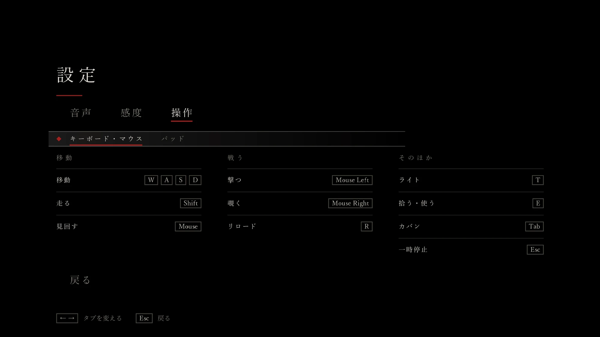

# LAST DROP

夜の町でガソリンを探し、ゾンビから逃げ切って車で脱出する一人称のゾンビシューターです。
## ゲーム概要

| 項目 | 内容 |
|---|---|
| ジャンル | 一人称のゾンビシューター（PvE・1 回勝負） |
| 目的 | 町のどこかの箱にあるガソリンを見つけ、脱出用の車の給油口に入れ、そばで 5 秒耐えると脱出 |
| 持ち物 | 拳銃と始まり、ライフル・弾・包帯は町で漁って手に入れる |

## 操作説明

- ゲームパッド（Xbox 系・DualSense）にも対応しています。割り当ては同じ画面の「パッド」で確認できます。

## ゲームの始め方

### 必要な物
- Windows 10 / 11（64 bit）
- DirectX11 が動く GPU

### ダウンロードと起動
1. [Releases](https://github.com/madoromi05/LastDrop/releases) からダウンロードします。
2. zip を展開します。設定を exe の隣に保存するので、`C:\Program Files` のような書き込めない場所は避けてください。
3. 展開した `LastDrop` フォルダの `LastDrop.exe` を起動します。

- 「Windows によって PC が保護されました」と出たときは、「詳細情報」→「実行」で起動できます

### ソースコードについて
このライセンスによりリポジトリには、素材（モデル・画像・音）は入っていません

## ライセンス表記

### ライブラリ

| 名前 | ライセンス | 同梱場所 |
|---|---|---|
| [Dear ImGui](https://github.com/ocornut/imgui) | MIT | `GameLib/src/ThirdParty/imgui/LICENSE.txt` |
| [miniaudio](https://miniaud.io/) | Public Domain または MIT No Attribution | `GameLib/src/ThirdParty/miniaudio/LICENSE` |
| [Recast & Detour](https://github.com/recastnavigation/recastnavigation) | zlib | `GameLib/src/ThirdParty/recastnavigation/License.txt` |

### 素材

- "G2 Combat Pistol" by Michael Karel, licensed under [CC BY 4.0](https://creativecommons.org/licenses/by/4.0/) (modified)
- "modular kit city builder starter kit" by Pieter Ferreira, licensed under [CC BY 4.0](https://creativecommons.org/licenses/by/4.0/) (modified)
- "Street Lights PBR" by wagner-daviana, CGTrader Royalty Free License
- "Post Apocalyptic UAZ" by BLND-studio, CGTrader Royalty Free License
- "Metal Jerrycan" by Sean Buckley・"Fire Hydrant" by Gonçalo Felício：[Poly Haven](https://polyhaven.com/)（CC0）
- キャラクターとアニメーション：[Adobe Mixamo](https://www.mixamo.com/)
