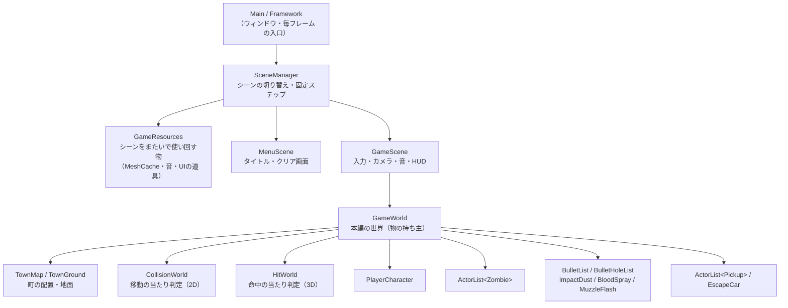
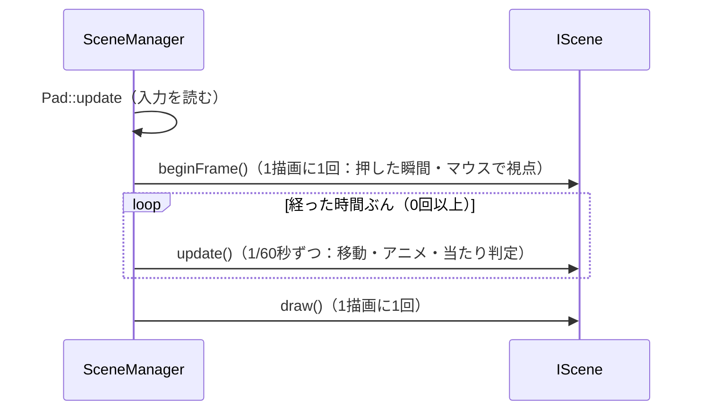
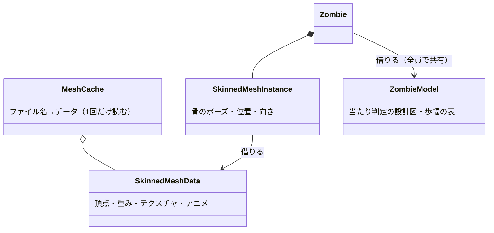
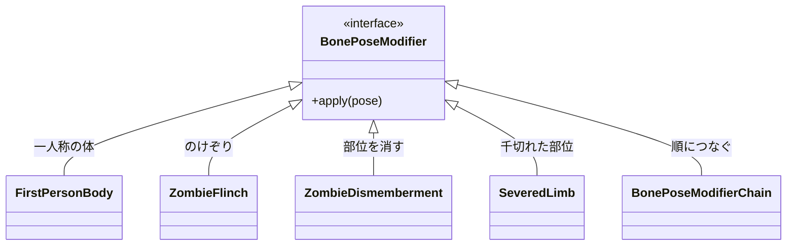
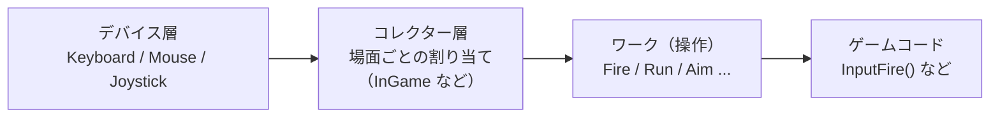
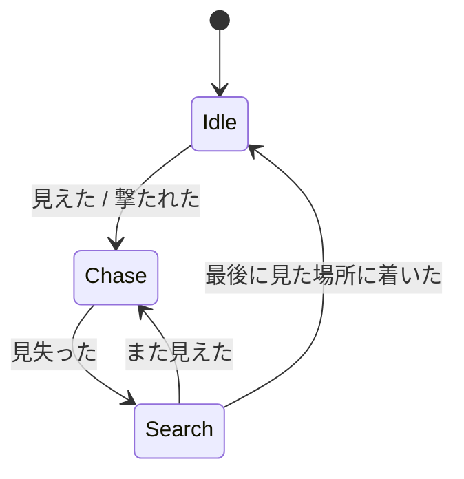

# ZombiFPS 技術まとめ（ポートフォリオ用）

最終更新：2026/10/19

> **この資料の使い方**
> - 自分用の「何を作ったか・なぜそうしたか」の整理ノート。面接やポートフォリオ資料の元ネタにする。
> - 1〜2章で全体像 → 3章でクラス設計 → 4章でアルゴリズム → 5章でアピールの仕方、の順に読む。
> - 図（```mermaid の部分）は GitHub か、VS Code に拡張機能「Markdown Preview Mermaid Support」を入れてプレビュー（Ctrl+Shift+V）すると絵で見られる。
> - 進捗や TODO は今まで通り `main.txt` が正。ここは「説明のしかた」をまとめる場所。

---

## 1. 作品概要

| 項目 | 内容 |
|---|---|
| タイトル（仮） | ZombiFPS ―「爽快さを追求したタルコフ」 |
| ジャンル | PvE ゾンビシューター FPS |
| ゲームの流れ | 町に置かれたガソリン3個を1つずつ車へ運び、町から脱出する |
| 言語・API | C++ / DirectX11 / HLSL |
| 土台 | GameLib（描画・数学・ファイル・入力の基盤ライブラリ）＋ miniaudio（音） |
| 開発期間 | 2026/05/30 〜（FPS としての本格開発は 2026/09 〜） |
| 規模 | ゲーム側（GameSrc）だけで 230 ファイル・約 13,900 行、シェーダ 7 本、自作ツール（Python 8 本＋C++ の音声合成ツール） |
| 素材 | キャラ・アニメは Mixamo。弾痕・血・砂ぼこり・マズルフラッシュの絵、足音などの音は自作ツールで生成 |

### GameLib（土台のライブラリ）のどこが自分の物か

面接では「このライブラリは自分で作ったの？」と必ず聞かれる。自分で書いた所と、元からあった所を分けて言えるようにしておく。
git の履歴から分かるのは次の通り（最初のコミット 2026/05/30 の時点で、GameLib は既に DirectX11 で動いていた）。

| 区分 | 中身 | 根拠（コミット） |
|---|---|---|
| 自分で追加 | 入力の3層構造（InputBuilder・InputConfig・InputCollector・InputDeviceCentor など。約1,900行） | 06/26「inputを三層構造にした」、07/30 |
| 自分で追加 | 描画の基盤：Shader・ConstantBuffer・RenderTarget・DepthTarget・VertexFormat（約1,000行） | 10/05「描画基盤の変更」 |
| 自分で追加 | ノーマルマップのシェーダ、GPU スキニング用の頂点（骨の番号・重み） | 09/21「ノーマルマップ追加」、10/05「GPU スキニング」 |
| 自分で追加 | miniaudio の組み込み | 10/01「音追加」 |
| 元からあった | 数学（Vector・Matrix）、コンテナ（Array・HashMap など）、ファイル読み書き、PseudoXml、スレッド、DirectX11 の描画の土台 | 最初のコミットに既にある |

> **自分で埋める**：最初のコミットより前のこと（GameLib を何から持ってきたか ― 本・授業・先輩など。DirectX11 化は自分でしたのか、元からだったのか）。git には残っていないので、自分の記憶で書く。
> **面接での言い方の例**：「数学やファイル読み込みなどの土台は既存のライブラリ（◯◯）を使い、入力の仕組みと描画の基盤（シェーダ・描画先）は自分で足しました。ゲーム側（GameSrc の約1.4万行）は全部自分で書いています」

### できていること（2026/10/19 時点）
- タイトル → 本編 → クリア の一周が遊べる
- 一人称の体が見える FPS（背骨の曲げ・ADS・反動・頭を消す）
- フルオート射撃、弾痕、着弾の砂ぼこり、マズルフラッシュ（点光源）、ブルーム
- ゾンビ：部位ごとの体力・ダメージ、のけぞり、よろけ、部位欠損（千切れて飛ぶ）、死亡 → 沈んで消える
- ゾンビ AI（気付く → 追う → 見失ったら最後に見た場所へ）
- 碁盤の目の町の自動生成、ガソリンのランダム配置、インタラクト（E）、インベントリ、HUD
- 3D 音声（足音は床の材質で変わる）、デバッグ表示（F1/F2/F3/F9）

---

## 2. 全体の構成



**ポイント**：「世界（GameWorld）」は入力・カメラ・音・HUD を知らない。シーンが世界を読んで動かす。
→ 世界のロジックだけを切り離して考えられ、テストや作り直しがしやすい。

### フォルダ（GameSrc）の分け方
| フォルダ | 役割 |
|---|---|
| Core | ゲームループの時計（FixedStepClock）、入力（Pad） |
| Scene | シーン管理、タイトル、本編、デバッグ表示 |
| World | 途中で増減する物の持ち主（ActorList） |
| Collision | 移動の当たり判定（SAT・掃引・滑る移動） |
| Hit | 命中の当たり判定（部位の箱・三角形） |
| Player / Weapon | 自キャラ、一人称の体、構え、連射、反動 |
| Zombie | ゾンビ本体、AI、体力、のけぞり、部位欠損 |
| Render | メッシュ、スキニング、カリング、ブルーム、板ポリの一括描画 |
| Effect | 血しぶき、砂ぼこり、マズルフラッシュ |
| Audio | 音の窓口、足音、環境音 |
| Map / Interaction / UI | 町、拾う・使う、画面の部品 |

---

## 3. クラス設計

### 3-1. ゲームループ：固定ステップ（FixedStepClock + IScene）



- **何をしている**：ゲームの更新は 1/60 秒（1ティック）ずつ、描画はモニターの速さで呼ぶ。経った時間を貯めて、ティック何回分かを数える。
- **工夫点**
  - 「1描画に1回でよい処理（押した瞬間の入力・マウスの視点回転）」を `beginFrame` に分けた。update が 0 回や 2 回のフレームでも、入力が消えたり2倍回ったりしない。
  - 処理が重くて追いつけないときは、上限（kMaxTicksPerFrame）を超えた分を捨てる（スパイラル・オブ・デス対策）。
- **面接での言い方**：「フレームレートに依存しない挙動にするため固定ステップにし、入力の取りこぼしが起きないよう処理を 3 つの段階に分けました」

### 3-2. シーン管理：切り替えは「予約」して後で行う（SceneManager）

- シーン一覧は `enum SceneId` の1か所に集める。
- ボタンを押した瞬間に切り替えると、**実行中のシーン自身が関数の途中で消えてしまう**。
  → `requestChange()` で予約だけして、`draw` の後に切り替える。
- 重い物（メッシュ・音）は `GameResources` が持ち、シーンを作り直しても読み直さない（Retry が速い）。

### 3-3. 物の寿命を設計で守る（GameWorld / ActorList / IWorldMember）

ゲームでよくあるクラッシュ原因は「消えた物を誰かが指している（ダングリングポインタ）」。これを**ルールで起きないようにした**。

| ルール | 実装 |
|---|---|
| 持ち主は1人 | `std::unique_ptr` で持つのは持ち主だけ。他は「借りるだけ」の生ポインタ |
| 消すのはティックの最後だけ | `ActorList::destroyLater()` で印を付け、`flush()` でまとめて消す（遅延削除） |
| 名簿への登録・解除は1か所 | `IWorldMember::addTo / removeFrom`。物の側が「どの名簿に何として載るか」を知っている |
| 壊れる順番も設計 | 名簿（CollisionWorld・HitWorld）を物より**先に宣言**＝物より**後に破棄**される |

```cpp
// ActorList の使い方（イメージ）
Zombie* z = mZombies.spawn( std::make_unique< Zombie >( ... ) ); // 持って、名簿へ載せる
mZombies.destroyLater( z );   // 印だけ付ける（update の途中でも安全）
mZombies.flush();             // ティックの最後に、名簿から外して消す
```

- **面接での言い方**：「消えた物を指すバグを“気を付ける”ではなく“構造で起きない”ようにしました。削除はティックの最後に限定し、名簿の登録解除も1か所に集めています」
- 2026-10-25 に ComponentSystem（Unity の GameObject＋Component と同じ考え方）へ置き換えた。`spawn / destroyLater / flush / find` の約束はそのまま `GameObjectWorld` が引き継いでいる。
  - 物（`GameObject`）は種類（タグ）と部品（`Component`）を持つだけで、振る舞いは部品（`Zombie`・`Pickup`）が持つ。
  - 更新は全部の部品へ自動で呼ばず、`GameWorld` が `forEach< Zombie >` のように種類ごとに決まった順で呼ぶ（順番がコードに見える）。
  - 部品の種類は自前の番号（RTTI を使わない）。種類ごとの並びも持つので、`forEach` は全部の物をたどらない。

```cpp
// GameObjectWorld の使い方（イメージ）
Zombie* z = mObjects.spawn( GameObjectTag::Zombie, std::make_unique< Zombie >( ... ) ); // 部品を付けた物を持ち、名簿へ載せる
mObjects.forEach< Zombie >( [ & ]( Zombie& zombie ) { zombie.update( ... ); } );       // 決まった順に種類ごとに呼ぶ
mObjects.destroyLater( z->gameObject() ); // 印だけ
mObjects.flush();                         // ティックの最後に、名簿から外して消す
```

### 3-4. インターフェースで役割を分ける

1つのクラスに全部を書かず、「何ができるか」をインターフェースで表している。


| インターフェース | 意味 | 使う側 |
|---|---|---|
| ICollisionBody | 移動を止める体（真上から見た長方形） | CollisionWorld |
| IHittable | 部位ごとに弾が当たる体 | HitWorld |
| IDamageable | ダメージを受けられる | GameWorld |
| IRayBlocker | 弾・視線を止める物（建物・地面・車） | HitWorld |
| IWorldMember | 名簿に自分を載せられる | ActorList |
| IInteractable | E キーで使える物 | Interactor |

- **工夫点**：当たり判定の名簿は「相手が何か（ゾンビか建物か）」を知らない。種類を増やしても名簿のコードは変わらない（開放閉鎖の原則）。
- `Interactor` は「当たった物が使える物か」を `std::function` の resolver で外から教えてもらう → Interactor はゲームの物の種類を知らずに済む。

### 3-5. 「設計図」と「1体ぶん」を分ける（Flyweight）

ゾンビを30体出しても重くならないよう、**全員で同じ物は1つだけ持つ**。



| 共有する（設計図） | 1体ごと |
|---|---|
| SkinnedMeshData（頂点・アニメ） | SkinnedMeshInstance（ポーズ） |
| HitboxLayout（どの骨にどんな箱） | HitboxSet（今の箱の位置） |
| ZombieStride（歩幅の表）・ZombieSeverLayout（切り方） | ZombieHealth・ZombieFlinch・ZombieDismemberment |
| TextureCache（同じ画像は1枚） | — |

### 3-6. アニメの上からポーズを書き換える差し込み口（BonePoseModifier）

`SkinnedMeshInstance` は「アニメの再生とクロスフェード」だけを知っている。ゲームの都合（視点で背骨を曲げる、部位を消す…）は **BonePoseModifier の派生クラス**に任せる（Strategy パターン。複数つなぐときは BonePoseModifierChain）。



- **工夫点**：書き換えるのは「見せるポーズ」の写しだけ。アニメのポーズ本体に書き換えが残ると、クロスフェードの混ぜ元に入り込んで**二重に掛かる**ため、分けて持っている。
- 当たり判定は書き換え**前**のポーズで取る（一人称で頭を潰した見た目ではなく、本来の体の位置で当てる）。

### 3-7. 入力の3層構造（デバイス → コレクター → ワーク）



- ゲームコードは `InputFire()` のように「何の操作か」だけを書く。キー・デバイスは一切知らない。
- キー割り当て（InputConfig）はファイルに保存・読み込みでき、キーコンフィグを後から作れる。
- 文字列（デバイス名・ワーク名）は InputBuilder.cpp の1か所だけで管理。

### 3-8. 音：外部ライブラリを隠す（AudioEngine、pImpl）

- `miniaudio.h` を読むのは AudioEngine.cpp だけ（pImpl）。ゲーム側は `SoundId` と位置を渡すだけ。
- バス（効果音 / 環境音）に分け、後で音量設定・ダッキングにつなげられる。
- 3D 音声（向きで左右・距離で減衰）、ドップラー、同じ音の別テイクと音程の揺らぎで「機械的に聞こえない」ようにしている。

### 3-9. UI

- `UiCanvas` が部品を持ち、マウス・キーの両方で選択／決定できる。
- 位置は「基準（左端・中央）からのずれ」で持つ（UiAnchor）。ウィンドウの縦横比が変わっても中央の物がずれない。
- `if constexpr` と `static_assert` で、選べる部品だけを自動で選択リストへ入れる（型で間違いを防ぐ）。

---

## 4. アルゴリズム

### 4-1. 移動の当たり判定：分離軸判定（SAT）＋掃引 ＋ 滑る移動
**ファイル**：`Collision/SweepMath.cpp`、`Collision/CharacterMover.cpp`

- **何をしている**：キャラを真上から見た「回転した長方形」として扱い、動かしたときに**一番早く当たる時刻**と面の向きを求める。
- **手法**
  1. **SAT**：2つの形を、それぞれの辺の向き（軸）へ影として落とす。どれか1本でも影が離れていれば当たっていない。
  2. **掃引（スイープ）**：軸ごとに「影が重なり始める時刻・離れる時刻」を求め、全軸で重なる一番早い時刻が当たった瞬間。→ 速く動いてもすり抜けない。
  3. **Collide-and-Slide**：当たったら面の少し手前まで進み、残りの移動から面へ向かう成分を消して壁に沿って滑らせる（最大3回）。
- **工夫点**
  - 面の「ちょうど上」で止めると誤差で次の判定が壁の内側から始まるので、1mm 手前で止める（Unity の skinWidth と同じ考え）。
  - 入り隅（2枚の壁の角）では左右に振動するので、前の面に入り込む向きになったら止める。
  - めり込んでいたら一番浅い軸の向きへ押し出す（群れに囲まれた時のために最大3回）。
  - 長方形どうしも、建物の多角形のかけらも「影」にすれば同じ計算で解ける形にまとめた。
- **なぜ 2D？**：歩く移動は水平だけなので 2D で十分。軽くて安定する。高さ（歩道の段差）は別に地面へ聞いて合わせる。

### 4-2. 建物の形に沿った壁を作る（Sutherland–Hodgman 法）
**ファイル**：`Collision/MeshWallBuilder.cpp`

- 建物のメッシュの三角形を、**体の高さの範囲（0.3m〜1.8m）だけ切り取って**壁のかけらにする。
- 切り取りは多角形クリッピングの定番 Sutherland–Hodgman 法。
- **効果**：足元の歩道の板や頭より上の庇は移動をふさがず、へこんだ入口や斜めの壁はそのままの形で当たる。
- 同じ向きの辺の法線は1本にまとめて、SAT で調べる軸を減らしている。かけらは数が多いので、届かない範囲の物は先に箱で捨てる。

### 4-3. 弾の当たり判定：スラブ法 ＋ Möller–Trumbore 法
**ファイル**：`Hit/HitMath.cpp`、`Hit/HitboxSet.h`、`Weapon/Bullet.cpp`

| 相手 | 形 | 手法 |
|---|---|---|
| キャラの部位 | 骨に付いた回転した箱（OBB） | 線分を箱の空間へ移し、-1〜1 の立方体とスラブ法で判定 |
| 建物・車・地面 | 三角形 | Möller–Trumbore 法 |

- **スラブ法**：x・y・z の軸ごとに「入る時刻・出る時刻」を求めて重ねる。重なりが無くなったら外れ。入った軸から面の法線も分かる。
- **OBB を単位立方体で扱う**：箱を「-1〜1 の立方体を置く行列」で持ち、逆行列で線分を立方体の空間へ移す。どんな向き・大きさの箱でも同じ計算で済む。
- **法線の変換**：拡大の入った行列で法線を移すときは (M⁻¹)ᵀ を使う（ただの M だと法線が曲がる）。
- **Möller–Trumbore**：三角形の中の点（u, v）と線分上の点（t）を連立で解く。弾痕を貼る向き・跳弾に使うため、法線は弾が来た側へ向ける。
- **弾は毎ティック「線分」で判定**：弾速 830m/秒（7.62×51mm NATO の初速）＝1ティック約 14m 進むが、通り道全体を線分で調べるのですり抜けない。

### 4-4. 部位の箱を頂点から自動で作る（主成分分析）
**ファイル**：`Math/BoxFitter.h`、`Hit/HitboxLayout.cpp`

- 部位ごとの頂点の集まりに沿った向きの箱を求める。
  1. 長い辺：関節を結ぶ向き（無ければ点の広がりが一番大きい向き＝主成分分析）
  2. 残りの2辺：長い辺に直交する面の中で、広がりが一番大きい向き
- 斜めに伸びた腕でも細長い箱になり、手で箱を置かなくてよい。
- 設計図（HitboxLayout）は全員で共有し、1体ごとに全頂点を調べ直さない。

### 4-5. ダメージ：全体の体力 ＋ 部位ごとの体力（テーブル駆動）
**ファイル**：`Zombie/ZombieHealth.cpp`

| 部位 | 部位の体力 | 倍率 | 0 で倒れる |
|---|---|---|---|
| 部位 | 部位の体力 | 倍率 | 1発のダメージ | 0 になるまで | 0 で倒れる |
|---|---|---|---|---|---|
| 頭 | 80 | 1.5 | 30 | 3発 | ○ |
| 胴 | 120 | 1.0 | 20 | 6発 | （全体と同じ） |
| 太もも | 60 | 0.75 | 15 | 4発 | × |
| 腕・すね | 40 | 0.5 | 10 | 4発 | × |

- 弾1発のダメージは 20（部位の倍率を掛ける前）。
- 全体（120）が 0、または「倒れる部位（頭）」が 0 で死亡。腕・脚が 0 になると千切れる（4-11）。
- 壊れた部位に当たっても全体の体力は減り続ける（腕を壊した後も、腕を撃ち続ければいつか倒れる）。
- 値は配列の表にまとめ、`static_assert` で「部位の数と表の数が同じ」をコンパイル時に確かめる（部位を増やして表を直し忘れるとビルドが通らない）。

### 4-6. ゾンビ AI：3つの状態 ＋ 負荷の分散
**ファイル**：`Zombie/ZombieChase.cpp`



- **見えているか**：ゾンビの目から自キャラの目へ線を引き、建物・車・地面に遮られていないか（50m 以内）。
- **工夫点**
  - **負荷の分散**：見通しの線は 0.2 秒に1回だけ。しかもゾンビごとに時刻をずらす（30体いても1ティックに数本）。
  - **ヒステリシス**：1.2m まで近づいたら止まり、1.5m 離れるまで歩き出さない。境目で「歩く・止まる」を繰り返さない。
  - 撃たれたら見えていなくても気付く（撃った場所が分かる）。
- 状態遷移（Zombie の State）は別に Alive → Downed → Falling → Corpse → Sinking を持ち、AI と生死を分けている。

### 4-7. 足が滑らない歩き（ルートモーションの代わり）
**ファイル**：`Zombie/ZombieStride.h`

- その場で歩くアニメ（根の骨が進まない）でも足が地面を滑らないように、**地面に着いている足先が後ろへ動いた長さだけ体を前へ進める**。
- ゾンビはびっこを引く歩き方（左右で歩幅も速さも違う）なので、一定の速さでは足が滑る。→ **フレームごとの表**を作った（1周 約1.0m）。
- 表は種類ごとに1つだけ作り、全員で共有。

### 4-8. アニメのクロスフェード（四元数の球面線形補間）
**ファイル**：`Render/SkinnedMesh/SkinnedMeshInstance.cpp`、`Math/MatrixBlend.cpp`

- 骨の行列を「移動・回転（四元数）・拡大」に分解し、回転は **slerp**、移動と拡大は線形補間して組み立て直す。
- **工夫点**
  - 混ぜ元は「切り替え直前に**実際に見えていた**ポーズ」の写し。前のアニメを動かし続ける方法だと、フェード中にもう一度切り替えたとき（歩き始めてすぐ止まる等）ポーズが飛ぶ。
  - 混ぜる割合は smoothstep（`t*t*(3-2t)`）。直線だと始まりと終わりで動きがカクッと変わる。
  - q と -q は同じ回転なので、内積が負なら裏返して近い回り方で補間。ほぼ同じ回転のときは正規化線形補間で代用（0割り対策）。
  - ポーズは「骨格の根から見た行列」で持つ。フェード中にキャラが移動・旋回しても、古いポーズが元の場所に取り残されない。

### 4-9. GPU スキニング
**ファイル**：`Render/SkinnedMesh/SkinningPipeline.cpp`、`Resource/Shader/SkinnedMesh.hlsl`

- 頂点の変形（4本の骨の重み付き合成）を CPU から GPU（頂点シェーダ）へ移した。
- 頂点は全キャラで共有し、骨の行列（3×4 行列 × 最大128本）だけを定数バッファで1体ごとに送る。
- 3×4 行列（float4 × 3行）にして、送るデータ量を 4×4 より 25% 減らしている。
- 1体ごとに持つのは骨のポーズだけで、**頂点の数に比例しない**。

### 4-10. 手続き的アニメーション（アニメ素材が無くても動きを作る）

#### 一人称の体（`Player/FirstPersonBody.h`）
タルコフのように「自分の体が見える FPS」を、Mixamo のアニメだけで作るための書き換え。

1. 視点の上下ぶん**背骨を3本に分けて**曲げる（1本だと腰から折れたように見える）
2. 右手首を曲げて銃の先を左手へ向ける（走りで左手が約8cm離れるのを直す）
3. 走るときは銃を胸元へ抱える
4. **手続き的 ADS**：銃のサイト線が目と視線に重なるよう、両腕をまとめて動かす（覗く専用アニメ不要）
5. 撃った反動で銃を後ろへ引き、銃口を跳ね上げる（目は動かさない＝照準はずれない）
6. 頭の骨を縮尺0にして潰す（カメラが頭の中にあるため、顔の裏が映るのを防ぐ）

#### のけぞり（`Zombie/ZombieFlinch.cpp`）
- 当たった部位の骨を、弾の向きへ曲げる。回す軸は「骨の向き × 押す向き」の外積。
- 毎ティック同じ割合を掛けて戻す（**指数減衰**。0.25秒で5%まで戻るよう係数を計算）。行き過ぎず滑らか。
- 上限 40 度で、フルオートで当て続けても曲がりすぎない。
- よろけ（gethit アニメ）は別に持ち、終わってから1秒は出さない（頭は必ず出す）。連射でよろけっぱなしにならない。

### 4-11. 部位欠損（骨を1点に潰す）
**ファイル**：`Zombie/ZombieDismemberment.h`、`Zombie/SeveredLimb.h`

- **体の側**：無くなった骨を全部、切り口の関節の**1点へ潰す**（縮尺0）。肩・肘のまわりの頂点は関節へすぼまるので、穴が空かない（蓋のメッシュを作らなくてよい）。
- **飛ぶ部位の側**：同じメッシュをもう1体描き、**逆に**千切れた部位以外の骨を潰す。部位ごとのメッシュを作らずに済む。
- 飛ぶ部位は切れた瞬間の姿勢で固め、弾の向きへ重力と回転で飛ばし、地面に着いたら止めて、10秒後に沈めて消す。
- 切れた部位の当たり判定（箱）も外す。脚を失ったら倒れたまま生きている（Downed）。

### 4-12. 描画の最適化
**ファイル**：`Render/ViewFrustum.cpp`、`Render/StaticMesh/StaticMeshMerger.h`、`Render/MeshCache.h`

| 手法 | 内容 |
|---|---|
| 視錐台カリング | 射影×ビュー行列の行を足し引きして6枚の面を取り出し（Gribb–Hartmann 法）、箱の「一番面の内側へ寄った隅」だけで判定（8隅全部を調べない） |
| バッチング | 道路の部品（何百枚）を、置いた後の形のまま種類ごとに1つのメッシュへ焼き込む → ドローコールを種類の数まで削減 |
| テクスチャの共有 | 同じ画像ファイルは1枚だけ読む（道路の部品9種が同じ絵） |
| 骨の番号引き | 毎フレームの骨の名前での文字列検索をやめ、番号で引く |
| 非同期読み込み | MeshCache がファイルを非同期で読み、終わった物から構築 |
| AI の分散 | 見通しの線を 0.2秒に1回・ゾンビごとにずらす |

- 次の計画（Optimization_Plan.txt）：建物のインスタンシング（192回 → 4回の見込み）、当たり判定の空間分割（ます分け）、LOD など。

### 4-13. ブルーム（明るい所をにじませる）
**ファイル**：`Render/Bloom.cpp`、`Resource/Shader/Bloom*.hlsl`

1. 描画先を RGBA16F（1 を超える明るさを持てる）にする
2. 明るさ 1 を超えた分だけを取り出す
3. 1/2 → 1/4 → 1/8 → 1/16 と縮めながらぼかす（4段）
4. 小さい段から順に、1つ大きい段へ加算して戻す

- マズルフラッシュの芯を「3倍の明るさ」で描き、光としてにじむようにしている（HDR → ブルームの流れ）。

### 4-14. エフェクトの一括描画（LitQuadBatch）
- 板ポリをためて1回で描く。2つのモード：
  - **LIT**：壁と同じライトで照らして半透明（弾痕・砂ぼこり）。弾痕は当たった面の法線で照らすので、壁と同じ明るさになる。
  - **GLOW**：ライト無しで加算（マズルフラッシュ）。加算なので描く順番を気にしなくてよい。
- 弾痕は同時16個まで、5秒から薄くして10秒で消す。付いた物が消えるときは一緒に消す。
- マズルフラッシュは「炎の形」ではなく「光」を目指し、光の芯＋**点光源**で周りの壁と自分の腕を一瞬照らす。

### 4-15. ランダム配置（部分的な Fisher–Yates シャッフル）
**ファイル**：`Map/SpawnPicker.cpp`

- 候補10か所から3か所を、重複なしで公平に選ぶ。全部を混ぜずに、選ぶ数だけ入れ替えて止める（O(選ぶ数)）。
- 種（seed）を渡すので、同じ種なら同じ配置を再現できる（デバッグしやすい）。

### 4-16. 町の自動生成（TownMap）
- 道の本数と部品の大きさから、道路キット9種類（直線・交差点・横断歩道・縁石・角…）の並びを組み立てる。
- 自キャラ・車・ガソリンの位置は**座標ではなく「道の番号」**で持つ → 町の形を変えても道の上に乗り続ける。
- 足元の部品の種類から床の材質を決め、足音を変える。

### 4-17. 音：足音のタイミングと自作の音声合成ツール
- **足音**（`Audio/FootstepEmitter.cpp`）：歩きアニメの位相（0〜1）が「足が着く位相（0 と 0.5）」を**またいだか**で鳴らす。1周して 0 に戻る場合も数える。動き出した最初のフレームは鳴らさない（前のアニメの位相と比べて誤って鳴るのを防ぐ）。
- **SoundGen**（`tools/SoundGen`）：足音・装備音・環境音を C++ で合成するツール。
  - 再現できる乱数（xorshift32）→ 作り直しても同じ音になる
  - RBJ の双2次バンドパスフィルタ、減衰する正弦波の束（床や金属の響き）、ノイズの粒（砂利・ガラス）、エコー、tanh のソフトサチュレーション、ループの継ぎ目消し
  - 足音 = かかとの低い衝撃 ＋ 靴底の擦れ ＋ 床の響き、のように部品を足して組み立てる

---

## 5. ゲーム会社にアピールできるポイント

優先順に並べた。面接・ポートフォリオでは上から話す。

### ① エンジンを使わず、FPS に必要な仕組みを一通り自分で作った
描画（スキニング・ポストプロセス）、当たり判定、AI、アニメ、音、UI、入力まで。
→ 「Unity/Unreal の中で何が起きているか」を理解している、と言える。

### ② 当たり判定を「目的ごとに」使い分けて、理由を説明できる
- 移動 → 2D の SAT＋掃引（軽い・安定・すり抜けない）
- 命中 → 3D の部位の箱（スラブ法）＋ 三角形（Möller–Trumbore）
- 建物 → メッシュを体の高さで切り取った壁
→ 「なぜその手法か」を言えるのが強い。

### ③ 「撃ち心地」へのこだわりを、手続き的アニメで実現した
ADS・反動・のけぞり・部位欠損を、専用のアニメ素材なしで作った。素材が足りない中で工夫した、という話はプランナー・エンジニア両方に響く。

### ④ 壊れにくい設計（寿命・所有権を構造で守る）
遅延削除（ActorList）、シーン切り替えの予約、宣言順＝破棄順、借用と所有の区別、`static_assert` によるコンパイル時チェック。
→ チーム開発で「バグを出しにくいコードが書ける人」と見てもらえる。

### ⑤ 増えても重くならない設計と最適化
Flyweight（設計図の共有）、GPU スキニング、視錐台カリング、バッチング、AI の負荷分散。最適化の計画書も作ってある。

### ⑥ 自分の制作パイプラインをツールで作った
Python：FBX → ゲーム用形式の変換、マテリアルのアトラス化、弾痕・血・砂ぼこり・マズルフラッシュの絵の生成。C++：音の合成ツール。
→ 「必要な道具を自分で作れる」はツールエンジニア・テクニカルアーティスト寄りのアピールにもなる。

### ⑦ 開発の進め方（仕様書 → 実装 → 週報）
機能ごとに仕様書（個別仕様/*.txt）を書いてから実装、毎週の報告書で進捗と課題を整理、デバッグ表示（F1 当たり判定・F2 物の透視・F3 体力・F9 ゾンビ出現）を用意。
→ 実際のゲーム会社の進め方に近い。

### さらに強くするために（やると効果が大きい順）
1. **数字で示す**：計測の仕組み（Profile 構成・F7 の CSV・ロードと重いフレームの内訳・GPU の時間）は 2026/10/24 にできた。
   テクスチャの圧縮でロードが約半分になった等の数字は **8 章**。残りは「ゾンビ ◯体で ◯fps」と、GPU の最適化の前後の数字。
2. **動画**：撃つ → のけぞる → 腕が千切れる → 倒れる、を 30秒〜1分の動画に。F1 の当たり判定表示を重ねたバージョンもあると技術が伝わる。
3. **GitHub で公開**（または提出用にコードを整理）し、README にこの資料の要約を載せる。

---

## 6. 面接で聞かれそうな質問と答え方のメモ

| 質問 | 答えの骨組み |
|---|---|
| なぜエンジンを使わなかった？ | 中の仕組みを理解したかった。当たり判定・スキニングなどを自分で書いたことで、エンジンを使うときも何が重いか分かるようになった |
| 移動の当たり判定を 2D にした理由は？ | 歩く移動は水平だけ。2D の方が軽く安定する。高さ（段差）は別に地面の高さを聞いて合わせている |
| 弾がすり抜けない理由は？ | 弾を点ではなく、1ティックの通り道の線分で判定しているから |
| 物を消すときに気を付けたことは？ | 更新の途中で消すと他が指したまま残る。印だけ付けてティックの最後にまとめて消す（ActorList） |
| ゾンビが増えたら重くならない？ | 設計図の共有・GPU スキニング・視線の分散で対策済み。次は当たり判定の総当たりを空間分割にする（課題として把握している） |
| クロスフェードで工夫したことは？ | 「見えていたポーズ」から混ぜるので、フェード中に切り替えてもポーズが飛ばない。slerp と smoothstep |
| 一番苦労したところは？ | （自分の言葉で）例：一人称の体。アニメのままだと手が銃から離れる・覗けない → 骨を手続き的に動かして解決 |
| 今の課題は？ | 当たり判定の総当たり（空間分割が必要）、AI が建物を回り込まない（NavMesh 予定）、ゾンビ同士の詰まり、効果を数字で測れていない |

---

## 7. 今の課題と次の一手（正直に言える形で）

| 課題 | 次の一手 |
|---|---|
| 地面の当たり判定が部品の総当たりで、ゾンビが増えるほど重い | ます分け（空間分割）→ 必要なら BVH |
| AI が建物を回り込まず、角で引っかかる | NavMesh（Recast）で経路探索 |
| ゾンビ同士が押し合って詰まる | 群れの分離（Separation）・経路の分散 |
| 遊んでいる間は GPU が重い（CPU 1.1ms・GPU 8.2ms。8 章 ③） | 背面カリング・描く順番（Early-Z）・頂点数の見直し・インスタンシング。前後を同じ場面で測って比べる |
| ダメージ・演出の値が初期値 | 画面を見ながら調整。値をファイルから読めるようにする |

---

## 8. 計測した数字（就活で使う用。2026/10/31 時点）

### 測った環境と方法
- **PC**：Intel Core i7-14700F／NVIDIA GeForce RTX 5070（VRAM 12GB）／メモリ 32GB／Windows 11
- **ビルド**：Profile 構成（最適化を掛けたまま計測の機能を使える、自分で足した構成）
- **解像度**：2560×1369（ウィンドウを画面いっぱいに広げた状態）、VSync 有効
- **道具**：自作の計測の仕組み（`GameLib/Profiling`。DebugTools_Profiling_Plan.txt）
  - F7 で 1 フレームごとの CSV（CPU の時間・Present の待ち・GPU の時間・区間ごとの時間）
  - ロードごとの内訳（`load_*.json`）、予算 16.67ms を超えたフレームの内訳（`spike_*.json`）
  - GPU の時間は D3D11 のタイムスタンプクエリで測る
- **数字の種類**：「実測」と「計算値」を分けて書く（面接では必ず言い分ける）

### ① テクスチャの圧縮（BC7 / BC5 の DDS 化）【実測＋計算値】
| | 前（TGA・圧縮なし） | 後（DDS・BC 圧縮） | 種類 |
|---|---|---|---|
| ゲームのロード全体 | 1,246〜1,349ms | **629〜644ms**（約半分） | 実測（各 2 回） |
| テクスチャの展開（メインスレッド） | 522〜541ms | **21〜23ms**（約 1/25） | 実測（各 2 回） |
| テクスチャのファイル | 372MB | **112MB** | 実測（ファイルの大きさ） |
| GPU のテクスチャのメモリ | 約 600MB | **約 112MB**（約 1/5） | 計算値（BGRA8＋ミップ と BC のブロックの大きさから） |

- **やったこと**：色の画像は BC7（sRGB）、法線マップは BC5 にし、ミップも前もって作ってファイルに入れた。
  Microsoft の texconv を呼ぶ変換ツールを PowerShell で作り、GameLib に BC の DDS の読み込みを自分で書いた（DdsReader）。
  見た目に対して大きすぎたゾンビのテクスチャは 4096² → 2048² に落とした。
- **なぜ速くなったか**：前は TGA を読むたびに CPU でミップ（縮めた絵）を作っていた。圧縮した絵はそのまま GPU へ送るだけになった。
- **言い方の例**：「テクスチャを GPU が直接読める BC 形式にして、ゲームのロードを 1.3 秒から 0.64 秒に、テクスチャの展開を 530ms から 22ms にした。
  GPU のメモリも計算で約 600MB から約 112MB になる」

### ② ロード直後のひっかかり【実測。2026/10/24】
- ゲームが始まった直後に **243ms** 止まるフレームがあった → 計測でテクスチャの展開と分かった
- テクスチャの展開が終わるまでロード画面のままにした → 遊び始めの最大のフレームは **30ms** に
- 代わりにロード画面は 0.75 秒 → 1.12 秒に延びた（止まる場所を「遊んでいる最中」から「ロード中」へ移した判断）
- ①の圧縮で、そのロードも 0.64 秒まで縮んだ

### ③ 遊んでいる間のフレーム時間【実測】
**VSync なし（本当の仕事の時間。2026/10/27 23:57・87,085 フレーム）**
| | 平均 | 50% | 99% | 最大 |
|---|---|---|---|---|
| フレーム全体 | **0.41ms** | 0.32ms | 1.42ms | 48.3ms |
| CPU | **0.32ms** | 0.28ms | 0.87ms | 7.8ms |
| GPU | **0.31ms** | 0.28ms | 0.67ms | 1.46ms |

- 目標の 144fps（1 フレーム 6.94ms）に対して、CPU も GPU も 20 分の 1 以下しか使っていない。今の町の規模では、どちらも余っている。
- GPU の時間は、記録を 6 つに分けても 0.28〜0.33ms で安定している（場面の違いで揺れていない）。
- 最大 48.3ms は 1 回だけ。更新・描画は 0.66ms で、残りは計測区間の外（ゲームの外の要因と見ている。未確定）。
- CPU が VSync ありの 1.1ms より小さいのは、主に、更新の無いフレームが増えたため。
  ゲームの更新は 1/60 秒ごとなので、フレームが速く回るほど、更新の無いフレーム（CPU は描くだけで軽い）の割合が増える。
  CSV の ticks 列（そのフレームで更新した回数）で分けて確かめた：

| | 更新の無いフレーム | その CPU 平均 | 更新 1 回のフレーム | その CPU 平均 | 更新 1 回の重さ |
|---|---|---|---|---|---|
| VSync あり（17:54） | 43.4% | 0.62ms | 56.6% | 1.55ms | 0.86ms |
| VSync なし（23:57） | **97.6%** | 0.31ms | 2.4% | 0.84ms | 0.48ms |

  更新 1 回の重さ（0.86ms と 0.48ms）や、更新の無いフレームの CPU（0.62ms と 0.31ms）も違うが、
  2 回の記録は場面（ゾンビの数や位置）が違うので、この差は比べられない（ゾンビの数は CSV に無く、確かめていない）。

**VSync あり（最初に測った数字。2026/10/27 17:54・5,382 フレーム）**
| | 平均 | 95% | 99% | 最大 |
|---|---|---|---|---|
| フレーム全体 | 9.4ms | 17.5ms | 20.7ms | 29.0ms |
| CPU | 1.1ms | 2.3ms | 3.3ms | 6.4ms |
| GPU（gpuMs。画面の更新待ちを含む） | 8.2ms | 15.8ms | 18.7ms | 23.7ms |

- 【訂正 2026/10/27】最初はこの表から「GPU が 8.2ms 使っている＝GPU バウンド」と読んだが、誤りだった。
  この GPU の数字は GPU が命令を待っていた時間を含んでいる（⑤で物ごとに分けて気づき、VSync を切って実測で確かめた）。
  フレーム時間を決めていたのは、CPU でも GPU でもなく画面の更新待ち。
- 16.67ms（60fps）を超えたのは 99% 点あたりから。20ms を超えたのは 84 回（1.6%）。
  その時の GPU の数字も 18〜22ms だが、上と同じ理由で、GPU が重かった証拠にはならない。

### ④ 130〜160ms の止まりの原因の切り分け【実測】
- 予算を超えたフレームの記録を読むと、ゲームの更新・描画はどれも 1ms 未満で、残りは計測区間の外の時間だった。
- コードと照らし合わせて、**シーンの切り替え**（新しいシーンを作り、前のシーンを消す）のフレームと特定した。遊んでいる最中の止まりではない。
- 圧縮の前にも同じ止まりがあったので、圧縮のせいではないことも記録から言える。

### ⑤ GPU の最適化（③の数字を根拠に入れた。その数字は後で読み違いと分かった。2026/10/27 実装・前後の比較は無し）
- **描く順番（Early-Z）**：手前に来やすい物から描く（自キャラの腕と銃 → ゾンビ → 建物を目に近い順 → 車・置物 → 地面）。
  先に描いた物に隠れる画素は、GPU がライト 4 つ＋法線マップの計算の前に捨てる。奥行きで隠すので絵は変わらない。
- **背面カリング**：全部両面で描いていたのを、メッシュは既定で裏を捨てるようにした。
  入れる前に、全メッシュの三角形の向きと法線をスクリプトで照らし合わせ、逆向きは各 0.1% 未満と確かめてから既定を変えた
  （穴が開く物だけ、メッシュのファイルで両面に戻せる）。
- **物ごとの GPU の時間**：GPU のタイムスタンプの印を、自キャラ・ゾンビ・建物・置物・地面・エフェクトの間に打ち、CSV の列にも出した。
  → 「どこが重いか」を数字で言え、前後の比較も物ごとにできる。
- **前後の数字**：前後の比較は無い。入れる前の数字は VSync を入れたまま測っていて、待ちを含むため比べられない。
  入れた後の本当の GPU の時間は全体で 0.31ms なので、2 つの最適化の効果は、あっても 0.3ms より小さい。
  今の規模では、効果を数字で示せる最適化ではなかった（後で物が増えたときの備えとして残す）。

| | 前（10/27 17:54・VSync あり） | 後（10/27 23:47・VSync あり） | 後（10/27 23:57・VSync なし） |
|---|---|---|---|
| GPU 平均 | 8.2ms（待ちを含む） | 7.8ms（待ちを含む） | **0.31ms** |
| GPU 99% 点 | 18.7ms（待ちを含む） | 16.1ms（待ちを含む） | **0.67ms** |

**物ごとの GPU の時間（VSync なし・平均。2026/10/27 23:57・87,085 フレーム）**
| ゾンビ | ポストプロセス | 建物 | 地面 | 自キャラ・弾 | 置物・エフェクト・UI | 合計 |
|---|---|---|---|---|---|---|
| 0.133ms | 0.080ms | 0.034ms | 0.027ms | 0.025ms | ほぼ 0 | **0.31ms** |

#### 物ごとに分けて分かったこと：VSync 中の gpuMs は待ちを含む【実測。2026/10/27】
- 物ごとの GPU の時間を見ると、全体の 97% が「ゾンビ」の区間（平均 7.6ms）に入っていた。
  ほかの区間（自キャラ・建物・置物・地面・ポストプロセス等）は合わせて平均 0.19ms。
- ゾンビの描画が重いのではなかった。根拠は 3 つ：
  - ゾンビの区間の時間と、Present で CPU が待った時間（presentMs）の相関が **0.996**
  - 隣り合うフレームで 4ms ↔ 10ms と交互に揺れる（描く量は変わらないのに）
  - ゾンビの区間から presentMs を引くと、中央値 **0.5ms** しか残らない
- 何が起きているか（推定）：GPU のタイムスタンプは「GPU が仕事をした時間」ではなく「印と印の間の時刻の差」。
  GPU は最初の印（自キャラ）までの命令を先に終え、残りの命令が届くまで何もせず待っている。
  その待ちが、次の印までの区間（ゾンビ）に入っていた。
- この時点では、本当の GPU の仕事を 1ms 前後と見積もった（ゾンビ以外 0.19ms ＋ ゾンビの区間から待ちを引いた 0.5ms）。
- **確かめ方**：F6 で VSync を切って測り直した。ゾンビの区間は **7.6ms → 0.13ms**、GPU 全体は **0.31ms**（上の表）。
  待ちを含んでいたという読みが実測で確かめられた（見積もりの 1ms より、さらに小さかった）。
  ③の「GPU バウンド」はこの待ちを数えた誤りだった。
- 学んだこと：VSync を入れたままでは、CPU も GPU も画面の更新待ちに見える（GameLib の BoundJudge にも同じ注意を書いていた）。
  合計の数字だけでは気づけず、区間に分けて別の数字（presentMs）と突き合わせて初めて分かった。
  数字を根拠に次の作業を決めるなら、その数字が何を測っているかを先に確かめる。
- **言い方の例**：「GPU が 8ms と出ていたので GPU 側を最適化したが、物ごとに分けて測ると、その大半は GPU が命令を待っている時間だった。
  Present の待ちとの相関が 0.996 だったことから気づき、VSync を切って測り直すと、本当の GPU の時間は 0.31ms だった。
  最適化の前後比較はできなかったが、測る数字の意味を確かめずに判断した失敗として、次からは測り方を先に決めている」

### ⑥ ディファードに切り替えた前後の GPU の時間【実測。2026/10/28】
- **やったこと**：G-Buffer 3 枚（色・法線＋鋭さ・スペキュラ）に描いてから、画面全体を 1 回なぞってライトを当てる形に変えた（グラフィック段階2）。
  ライトの式はフォワードと同じ関数を使い、絵は変えずに描く経路だけを移した。F6 でフォワードに戻して見比べ・計測できる。
- **測り方**：Profile ビルド・VSync なし。Deferred と Forward は別々に起動して録った（13:36・89,143 フレーム／19:30・144,791 フレーム）。
  同じ起動の中で切り替えて録ったものではないので、ゾンビの数や視点は揃っていない。

| | Forward（前） | Deferred（後） | 差 |
|---|---|---|---|
| GPU 全体（中央値） | 0.340ms | 0.345ms | **+0.005ms** |
| GPU 全体（平均） | 0.357ms | 0.461ms | +0.10ms（ゾンビの場面の違いを含む） |
| GPU 全体（99%） | 0.80ms | 1.42ms | 場面の違いを含む |
| 建物（平均） | 0.040ms | 0.065ms | +0.025ms |
| 地面（平均） | 0.022ms | 0.034ms | +0.012ms |
| ライティングのパス（平均） | なし | 0.056ms | +0.056ms |
| ゾンビ（中央値） | 0.164ms | 0.073ms | 場面の違い（下を参照） |
| ポストプロセス（平均） | 0.081ms | 0.082ms | 変わらない |

- **読み方**：
  - ディファードで増えた仕事は「G-Buffer に 3 枚書く」と「ライティングのパス」。建物・地面・ライティングを足すと **約 +0.09ms**。
    建物と地面は場面でほとんど揺れない（99% 点も 0.1ms 前後）ので、この差は描き方の差と読める。
  - ゾンビの区間は中央値が Deferred の方が小さい。ゾンビの描き方はどちらもライトを当てるか G-Buffer に書くかの違いだけなので、
    半分以下になるとは考えにくく、映っていたゾンビの数の違いと見ている（ゾンビの数は CSV に無く、確かめていない）。
  - 全体の中央値はほぼ同じ。今の規模（ライト 4 つ・物が少ない）では、ディファードは速くも遅くもならない。
- **なぜ移したか**：速くするためではなく、段階3 以降（ライトを増やす・SSAO・影）の土台。フォワードはライトが増えると
  「物の数 × ライトの数」で重くなるが、ディファードはライトの数 × 画面の画素で済む。今は増えた分の +0.09ms を払っている状態。
- **言い方の例**：「ディファードに移して GPU の時間は中央値で 0.34ms のまま、増えた固定の仕事は約 0.09ms。
  今は速くするためではなく、ライトや SSAO を増やすための土台として入れた」
- **途中で起きたこと**：最初のディファードは画面が真っ暗だった。G-Buffer を描くときに前の半透明のブレンドが残り、
  アルファにデータを入れた G-Buffer が書かれなかった。結果を色分けで出して切り分け、描画先を切り替える所でブレンドも自分で設定するようにした。

### ⑦ PBR と夜のライト（ライト 16 個）を入れた後の GPU の時間【実測。2026/10/29】
- **やったこと**：グラフィック段階3。式を PBR（Lambert＋Cook-Torrance GGX）にし、ライトを自前の一覧（平行光・点光源・スポット、最大 16 個）にした。
  月・空のグラデーション・半球の環境光で夜にし、交差点 16 か所の街灯と、銃の懐中電灯（T）を足した。
  夜のライトの候補は 19 個（月・懐中電灯・マズルフラッシュ・街灯 16）で、16 個を超えた分は目から遠い街灯から外す。
- **測り方**：Profile ビルド・VSync なし・2560×1369・91,538 フレーム（01:17・72 秒）。比べる相手は⑥の Deferred（段階2。ライト 4 つ・昼）。
  起動は別なので、ゾンビの数や視点は揃っていない。

| | 段階2（Deferred・ライト 4） | 段階3（夜・ライト 16） | 差 |
|---|---|---|---|
| GPU 全体（中央値） | 0.345ms | 0.679ms | +0.33ms |
| ライティングのパス（中央値） | 0.053ms | **0.442ms** | **+0.39ms** |
| ライティングのパス（99%） | 0.100ms | 1.20ms | |
| 建物（平均） | 0.065ms | 0.075ms | ほぼ同じ |
| 地面（平均） | 0.034ms | 0.026ms | ほぼ同じ |
| ポストプロセス（平均） | 0.082ms | 0.074ms | ほぼ同じ |

- **読み方**：
  - 増えたのはライティングのパスだけ。G-Buffer に描く物（建物・地面）は変わらない（ディファードなので、ライトが増えても物を描く回数は増えない）。
  - ライティングのパスは、画面の全部の画素でライト 16 個を回す。増えた 12 個で約 0.39ms なので、**ライト 1 個あたり約 0.03ms**（2560×1369 ＝ 350 万画素）。
  - 記録を 1 万フレームずつ 10 に分けても、ライティングのパスは 0.42〜0.53ms で安定している（場面でほとんど揺れない。画素の数とライトの数だけで決まるため）。
  - Graphics_Spec の目標（ライティング 2.0ms・GPU 全体 約 10ms。1920×1080 で 60fps）に対して、まだ十分に余裕がある。
  - 次に効いてくるのはライトの数。16 個を超えて増やすなら、画面をタイルに分けてライトを振り分ける方式（Tiled / Clustered）を考える。
- **言い方の例**：「ディファードで夜の町にライトを 16 個置き、GPU の時間はライティングのパスだけが 0.05ms から 0.44ms に増えた。
  ライト 1 個あたり約 0.03ms と測れているので、これ以上増やすときの判断材料にしている」
- **途中で起きたこと**：
  - 最初の計測は VSync が入ったままで、GPU 全体が 8.7ms と出た（③と同じく、画面の更新待ちがゾンビの区間に入る）。VSync を切って測り直した。
  - 懐中電灯の強さは、腰だめでは銃口が視線より約 12° 下を向き、光が道路に浅い角度で当たることを数字を書き出して確かめてから決めた。

### ⑧ 影（懐中電灯の影＋月の CSM 3 枚）の重さ【実測。2026/10/29】
- **やったこと**：グラフィック段階4。懐中電灯の影（1024² の透視の影のマップ 1 枚）と、月の影（カメラからの距離で 3 枚に分けた 2048² の CSM）。
  影のマップを描くパスは、描き方の切り替え（RenderPass）に「影」を足しただけで、建物・ゾンビの描画のコードは変えていない。
  影の縁は 3×3 の PCF、面の縞（にきび）は読む位置をずらして止めた。F6 で影の ON / OFF を切り替えられる。
- **測り方**：Profile ビルド・VSync なし・2560×1369・夜・懐中電灯 ON。**同じ起動・同じ場所で、影の ON と OFF を続けて録った**
  （⑥では起動が別で場面が揃わなかった反省）。1 本の記録の途中で切り替えたので、影のパスの時間（gpu.Shadow）でフレームを分けた。
  ON 62,874 フレーム／OFF 46,206 フレーム（01:31〜01:33）。

| | 影 OFF | 影 ON | 差 |
|---|---|---|---|
| GPU 全体（中央値） | 0.726ms | 0.926ms | **+0.20ms** |
| 影のマップを描く（gpu.Shadow。中央値） | 0.009ms | 0.147ms | +0.14ms |
| ライティングのパス（中央値） | 0.508ms | 0.577ms | +0.07ms（影を読む 3×3 回 × 懐中電灯と月） |
| CPU（中央値） | 0.315ms | 0.499ms | **+0.18ms** |
| CPU の描画（Scene.draw。中央値） | 0.145ms | 0.314ms | +0.17ms（影を落とす物を 4 回描く命令） |
| 建物・地面・ポストプロセス | 0.07・0.02・0.06ms | ほぼ同じ | |

- **読み方**：
  - 影を付けると GPU が約 0.2ms 増える。内訳は「影のマップを 4 枚描く」0.14ms と「照らすときに影を読む」0.07ms。
  - CPU も約 0.18ms 増えた。GPU の仕事より、影のマップ 4 枚ぶん描く命令を出す CPU の時間の方が同じくらい効いている
    （影を落とす物を 4 回描くので、描く命令が 4 倍近くになる）。物が増えたら、CPU 側の方が先に効いてくる見込み。
  - Graphics_Spec の目標（影 2.0ms）に対して 0.15ms で、十分に余裕がある。
  - 揺れ：影 ON の 99% 点は gpu.Shadow 0.68ms。ゾンビが多く映る・月の影の広い枚に建物が多く入る場面で上がると見ている（未確定）。
- **言い方の例**：「懐中電灯の影と月の影 3 枚を足して、GPU は 0.2ms・CPU は 0.18ms 増えた。同じ場面で ON / OFF を切り替えて測り、
  GPU の増えた分を『影のマップを描く』と『影を読む』に分けて説明できる。CPU の描く命令も同じくらい増えるので、次に減らすならそちら」
- **途中で起きたこと**：最初の計測は VSync が入ったままで、待ち時間が一番最初の区間（影）やゾンビ・建物の区間に入れ替わりで入り、
  区間ごとの数字が読めなかった（③⑦と同じ）。VSync を切って測り直した。

### ⑨ 霧・カラーグレーディング・ディザ・FXAA（夜の絵の仕上げ）の重さ【実測。2026/10/30】
- **やったこと**：グラフィック段階5。霧（距離の霧を 2 乗の指数で＋地面近くの高さの霧。深度だけ読む全画面のパス 1 回）、
  ACES の後のカラーグレーディング（色温度・彩度・コントラスト・暗部／中間／明部の色）、8bit に落とす直前のディザ、
  自分で書いた FXAA（FXAA 3.11 Quality の手順。輪郭に沿って端を 5 回探す）。どれも F6 で ON / OFF できる。
- **測り方**：Profile ビルド・VSync なし・2560×1369・夜・懐中電灯 ON。**同じ起動・同じ場所で**、A 全部 ON → B 霧だけ OFF → C FXAA だけ OFF を
  続けて録った（⑧と同じやり方）。1 本の記録の途中で切り替えたので、gpu.Fog と gpu.FXAA に時間が付くかどうかでフレームを分けた。
  A 34,095／B 39,565／C 39,113 フレーム（01:00〜01:02）。グレーディングとディザは OFF でも同じ式を通す作りなので、ON / OFF では測れない。
  画面全体に掛ける固定の処理なので、写す処理の時間（gpu.PostProcess）を⑧の記録と比べた。

| | 中央値 | 99% 点 | 比べた物 |
|---|---|---|---|
| 霧のパス（gpu.Fog） | **0.034ms** | 0.34ms | B（霧 OFF）は 0.000ms |
| FXAA（gpu.FXAA） | **0.048ms** | 0.19ms | C（FXAA OFF）は 0.000ms |
| 写す処理（gpu.PostProcess。ブルーム・ToneMap・グレーディング・ディザ） | 0.075ms | 0.36ms | ⑧の記録では 0.059ms → **+0.016ms** |
| GPU 全体 | 1.040ms（A） | 1.81ms | B 0.982ms・C 1.000ms・⑧の影 ON 0.926ms |
| CPU | 0.480ms（A） | 1.14ms | B・C も 0.50ms 前後（変わらない） |

- **読み方**：
  - 霧は 0.034ms、FXAA は 0.048ms、グレーディング＋ディザは約 0.02ms。3 つ合わせて約 0.1ms で、⑧から GPU 全体が増えた分（0.926 → 1.040ms、+0.11ms）とほぼ合う。
  - Graphics_Spec の目標（霧・半透明 0.5ms、ToneMap・FXAA 0.5ms。1920×1080 で）に対して、それより広い 2560×1369 で 0.03ms・0.12ms。十分に余裕がある。
  - CPU は増えていない。どれも全画面を 1 回描くだけで、描く命令は 1〜2 本しか増えないため（⑧の影は物を 4 回描くので CPU も増えた。その違いを説明できる）。
  - 区間の差だけで見ると、霧の分（A − B）は +0.058ms、FXAA の分（A − C）は +0.040ms。ただし霧と関係の無いライティングのパスも、区間によって
    0.55〜0.62ms と 0.06ms ほど揺れている。なので、重さの数字には区間の差ではなく、そのパスの印の時間（gpu.Fog・gpu.FXAA）を使う。
  - 揺れ：99% 点は霧 0.34ms・写す処理 0.36ms と、中央値の 10 倍近い。影など他の区間の 99% 点も同じ頃に上がっていて、GPU の速さ（クロック）が
    下がった瞬間と見ている（未確定）。
- **言い方の例**：「霧と FXAA と色の調整を全部足しても、GPU は 0.1ms ほどしか増えていない。全画面を 1 回描くだけの処理なので、
  CPU は増えない。ON / OFF を同じ場面で切り替えて測り、区間ごとの揺れ（0.06ms）より小さい差は、そのパスの印の時間で言うようにした」
- **作るときに決めたこと**：霧はシーンの色を読まず、霧の色と量だけを出して混ぜる（写し直しが要らない）。FXAA は ON のときだけ 8bit の中間を通し、
  OFF のときは今までどおり画面へ直接写す（OFF が「FXAA 無し」の比べる元になる）。

### ⑩ SSAO（物の隙間の暗がり）の重さ【実測。2026/10/30】
- **やったこと**：グラフィック段階6。法線の向きの半球で調べる SSAO（12 点）を画面の半分の大きさで作る。
  奥行きを見たぼかしを横 → 縦の 2 回掛け、奥行きを見ながら元の大きさへ拡大し、環境光にだけ掛ける（懐中電灯・街灯で照らした所は暗くしない）。
  F6 で ON / OFF できる。
- **測り方**：Profile ビルド・VSync なし・2560×1369・夜・懐中電灯 ON。建物の角と車が映る所で、**同じ起動・同じ場所・同じ向きで**
  A 全部 ON（約 52 秒）→ B SSAO だけ OFF（約 50 秒）を続けて録った（⑧⑨と同じやり方）。gpu.SSAO に時間が付くかどうかでフレームを分け、
  切り替えの前後と最初・最後の 1 秒は使わなかった。A 36,565／B 41,233 フレーム（Profiling/20261030_142955/perf_20261030_143014.csv）。

| | 中央値 | 99% 点 | 比べた物 |
|---|---|---|---|
| SSAO を作る＋ぼかす（gpu.SSAO） | **0.114ms** | 0.42ms | B（SSAO OFF）は 0.000ms |
| ライティング（gpu.Lighting。拡大して読む分が入る） | 0.627ms（A） | 1.59ms | B 0.584ms → +0.043ms |
| GPU 全体 | 1.195ms（A） | 2.41ms | B 1.028ms → **+0.167ms** |
| CPU | 0.495ms（A） | 1.12ms | B 0.491ms（変わらない） |

- **読み方**：
  - SSAO の重さは、作る＋ぼかすが 0.114ms、ライティングで拡大して読む分が約 0.04ms で、**合わせて約 0.16ms**。
    GPU 全体の差（+0.167ms）とほぼ合う。
  - Graphics_Spec の目標（SSAO 1.0ms。1920×1080 で）に対して、それより広い 2560×1369 で 0.16ms。半分の大きさで作った効果が大きい
    （計算する画素は 1/4）。
  - ライティングの差（+0.043ms）は、⑨で見た区間ごとの揺れ（0.06ms）より小さい。なので「拡大の分」とは言い切らず、GPU 全体の差と
    gpu.SSAO の合計が合うことを根拠にする。
  - CPU は増えていない。全画面を 3 回（作る・横・縦）描くだけで、描く命令が 3 本増えるだけのため。
- **言い方の例**：「SSAO は半分の解像度で作って、奥行きを見ながらぼかして拡大した。2560×1369 で GPU は 0.16ms 増えただけ。
  暗がりは環境光にだけ掛けているので、懐中電灯で照らしたゾンビは暗くならない」
- **作るときに決めたこと**：奥行きを AO と同じ描画先の 2 つ目のチャンネル（RG16F）に入れた。ぼかしと拡大が深度を読み直さずに、
  輪郭（ゾンビと奥の壁の間）をまたがないようにできる。
- **半透明のパス（参考の値）**：壁から 2〜3m で壁をフルオートで撃ち続けた記録（Soft particles ON・VSync なし・13 秒。
  Profiling/20261030_144633/perf_20261030_144709.csv）。gpu.Effects が 0.01ms を超えたフレーム（撃っている間）と、それ以外に分けた。

| | 撃っている間（4,324 フレーム） | 撃っていない間（4,388 フレーム） |
|---|---|---|
| 半透明のパス（gpu.Effects。砂ぼこり・血・マズルフラッシュ・弾痕。ソフトパーティクル込み） | **0.141ms**（99% 0.44ms） | 0.005ms |
| GPU 全体 | 1.401ms | 1.210ms |
| CPU | 0.514ms | 0.538ms |

  - 板を壁の近くで薄くする処理まで込みで、撃っている間も 0.14ms。霧（⑨の 0.034ms）と足しても、目標の「霧・半透明 0.5ms」の 4 割以下。
  - Soft particles OFF の記録は録っていない。なので「ソフトパーティクルの分だけの重さ」は言えない。言うのは「込みで 0.14ms」まで。
  - 板の数は撃ち方で変わるので、この数字は「この撃ち方のとき」の参考の値として言う。

### ⑪ SSR（映り込み）・デカール・材質テクスチャの重さ【実測。2026/10/30】
- **やったこと**：グラフィック段階7。雨上がりの水たまり（ワールドの位置で読む模様。道路だけ）と、車・道路・ガソリン缶の材質の画像（AO・粗さ・金属）。
  SSR は画面の半分の大きさで、反射の向きへ 24 歩進み、当たったら二分探索で 4 回詰め、照らした後の色を映す。奥行きを見たぼかしと拡大をして、
  環境光の空の映り込みと入れ替える。弾痕は G-Buffer に書くデカール（箱を描いて深度から位置を戻す）にし、G-Buffer へ描く順番を
  「動かない物 → デカール → 動く物」にして、キャラに弾痕が乗らないようにした。どれも F6 で ON / OFF できる。
- **測り方**：Profile ビルド・VSync なし・2560×1369・夜・懐中電灯 ON。水たまりと車が映る所で、**同じ起動・同じ場所・同じ向きで**
  A 全部 ON（約 40 秒）→ B SSR だけ OFF（約 30 秒）を続けて録った（⑧〜⑩と同じやり方）。gpu.SSR に時間が付くかどうかでフレームを分け、
  切り替えの前後と最初・最後の 1 秒は使わなかった。A 24,320／B 18,830 フレーム（Profiling/20261030_173059/perf_20261030_173706.csv）。

| | 中央値 | 99% 点 | 比べた物 |
|---|---|---|---|
| SSR を作る＋ぼかす（gpu.SSR） | **0.105ms** | 0.66ms | B（SSR OFF）は 0.000ms |
| SSR を混ぜる（gpu.SSR composite） | **0.101ms** | 0.41ms | B は 0.000ms |
| GPU 全体 | 1.483ms（A） | 2.74ms | B 1.228ms → **+0.255ms** |
| CPU | 0.572ms（A） | 1.29ms | B 0.576ms（変わらない） |
| デカール（gpu.Decals。弾痕があったフレーム） | 0.002ms | 0.011ms | 弾痕が無いときは 0 |
| G-Buffer の物ごとの印の合計（建物・置物・地面・デカール・自キャラ・ゾンビ） | 0.144ms（A） | 0.54ms | ⑩の記録 0.123ms（場所が違うので参考） |

- **読み方**：
  - SSR の重さは、作る＋ぼかすが 0.105ms、混ぜるが 0.101ms で、**合わせて約 0.21ms**。GPU 全体の差は +0.255ms で、残りの約 0.05ms は
    ライティングの区間の揺れ（A 0.674・B 0.621ms。⑨⑩でも 0.06ms ほど揺れた）と同じくらい。
  - Graphics_Spec の目標（SSR 1.5ms。1920×1080 で）に対して、それより広い 2560×1369 で約 0.21ms。半分の大きさで作り、粗さの低い画素だけ
    進めるので軽い。混ぜるパスは画面全体を 1 回描くので、作るパスと同じくらいの重さになった。
  - CPU は増えていない（全画面を 4 回描くだけ）。
  - デカールは弾痕 1 つにつき箱 1 つ（三角形 12 枚）を描くだけで、0.002ms とほとんど 0。
  - G-Buffer の合計は⑩から +0.02ms ほど。描く順番を変えた分（自キャラを最初に描かなくなった）と、材質の画像・水たまりの模様を読む分を
    合わせた目安で、場所も違うので「大きくは増えていない」とだけ言う。
- **言い方の例**：「SSR は半分の解像度で、つやのある画素だけ光線を進めた。空の映り込みと入れ替える混ぜ方にして、二重に明るくならないようにした。
  2560×1369 で GPU は 0.2ms ほど。弾痕はデカールにして、G-Buffer の描く順番を変えるだけでキャラに乗らないようにした」
- **作るときに決めたこと**：SSR の結果は「色 × 確からしさ」で持つ（ぼかしても黒くにじまない）。道路の材質の画像は、作者の金属の値（アスファルトが 0.5）が
  おかしかったので使わず、粗さだけ使った。
- **気を付けること**：デカールだけを撃ち続けて測る記録（手順の記録 2）は録れていない（2 本目の記録は 2 秒だけ）。デカールの数字は記録 1 の中で
  弾痕が残っていたフレームの値で、弾痕の数（最大 16 個）は数えていない。
- **計測の道具の不具合**：GPU の印が 1 フレーム 12 個までで、段階 6・7 で 16 個になって後ろの 4 つ（Effects・PostProcess・FXAA・GBufferView）が
  CSV から消えていた（Rest にまとめられていた）。上限を 20 に上げた（2026-10-30）。この記録の SSR・Decals・G-Buffer の列は 12 個の中なので正しい。

### ⑫ TAA（時間をまたいだアンチエイリアス）の重さ【実測。2026/10/30】
- **やったこと**：グラフィック段階8。描く行列を毎フレーム 1 画素より細かくずらし（Halton 8 個）、霧の後に前のフレームまでの絵（履歴）と混ぜる。
  **速度の描画先と前のフレームの骨の行列は作らなかった**：前の位置は深度と前のフレームのカメラの行列から出し、G-Buffer の空きチャンネルに
  「動きの種類」（町・ゾンビ・手元）を書いて分けた。手元の銃と腕はカメラと一緒に動くので「同じ画素の前の色」を読み、ゾンビは周りの色で強めに抑える。
  履歴は Catmull-Rom で読み（読み直すたびにぼけない）、周り 3×3 の色の分散で残像を抑え、明るさで割り戻して混ぜる。
  SSAO・SSR・ディザのノイズも毎フレーム動かし、TAA に均させた。F6 で Off / FXAA / TAA を選べ、初期値は TAA。
- **測り方**：Profile ビルド・VSync なし・2560×1369・夜・懐中電灯 ON。**同じ起動・同じ場所・同じ向きで**
  Off（約 42 秒）→ FXAA（約 33 秒）→ TAA（約 24 秒）を続けて録った。gpu.TAA・gpu.FXAA に時間が付くかどうかでフレームを分け、切り替えの前後と
  最初・最後の 1 秒は使わなかった。TAA 13,309／FXAA 19,771／Off 26,540 フレーム（Profiling/20261030_195157/perf_20261030_195430.csv）。

| | 中央値 | 99% 点 | 比べた物 |
|---|---|---|---|
| TAA（gpu.TAA。混ぜる＋シーンの色へ写し戻す） | **0.149ms** | 0.61ms | Off・FXAA は 0 |
| FXAA（gpu.FXAA） | 0.045ms | 0.25ms | ⑨の 0.048ms とほぼ同じ |
| GPU 全体 | TAA 1.532ms・FXAA 1.439ms・Off 1.379ms | 3.03ms（TAA） | TAA は Off から **+0.153ms** |
| CPU | TAA 0.626ms・FXAA 0.599ms・Off 0.559ms | 1.53ms（TAA） | 下の「読み方」 |
| SSAO・SSR（ノイズを毎フレーム動かした） | SSAO 0.115ms・SSR 0.101ms（TAA） | | Off でも 0.115・0.105ms（変わらない） |

- **読み方**：
  - TAA の重さは 0.149ms で、GPU 全体の差（Off から +0.153ms）とほぼ合う。Graphics_Spec の目標（ToneMap・FXAA 0.5ms。1920×1080 で）に対して、
    それより広い 2560×1369 で 0.15ms。FXAA の約 3 倍だが、ちらつきが消え、SSAO・SSR のざらつきも均せる。
  - ノイズを毎フレーム動かしても、SSAO・SSR の重さは変わらない（式に足し算が 1 つ増えるだけ）。
  - CPU は Off 0.559 → FXAA 0.599 → TAA 0.626ms と順に増えたが、CPU の処理がほぼ無い FXAA でも 0.04ms 増えている。録った順（Off → FXAA → TAA）に
    場面が少しずつ変わった分（GPU 全体も Off の区間の中で 1.44 → 1.58ms と上がっていった）と見ていて、TAA が CPU に足したのは
    行列の逆 1 つと描く命令 2 本だけ。なので「CPU はほとんど増えない」とだけ言う。
- **言い方の例**：「TAA は速度バッファを作らず、深度とカメラの行列から前の位置を出した。一番残像が出やすい手元の銃は、カメラと一緒に動くので
  画面の同じ画素を読ませた。2560×1369 で GPU は 0.15ms。FXAA では消えない細い物のちらつきが消える」
- **作るときに決めたこと**：G-Buffer のデカールの混ぜ方が、アルファにある「動きの種類」を上書きしてしまう不具合に気付き、
  GameLib に「色だけ混ぜてアルファを残す」混ぜ方を足した。TAA は半透明の板の前に入れ、マズルフラッシュに光の尾が出ないようにした。

### ⑬ 地面のます・同じ設定を送らない・頂点数を減らす（最適化 S-6・S-4・S-2）【実測。2026/10/31】
- **やったこと**（OptimizationS246_Plan.txt）：
  - **S-6 地面のます**：足元の高さ・材質・弾の当たりは、地面の部品 522 枚を毎回全部調べていた。上から見て 4m のますに分け（GroundGrid）、
    線分が通るますにかかる部品だけを調べる。線分は 2D の DDA（Amanatides & Woo）でたどり、2 つのますにかかる部品は印で 1 回だけ調べる。
    入れてからしばらくは、全部調べた答えと毎回比べ、遊んで 1 度も食い違わないのを確かめてから比べる処理を消した。
  - **S-4 同じ設定を送らない**：GameLib の側で「値が同じなら何もしない」にした。画像は同じ物を付け直さず、シェーダは法線マップの有無が
    変わったときだけ選び直す。材質の色・強さは値が変わったときだけ PS の定数を送り直す印を立てる。PBR の値と ORM の画像も直前と同じなら送らない。
    （「直前に使った材質を覚えて飛ばす」案は、間で別の物が設定を変えると古い値のまま描くので採らなかった）
  - **S-2 頂点数**：変換ツールに三角形の上限を足した（Blender の Decimate）。車 118,411 → 29,991・ガソリン缶 5,897 → 1,000・自キャラ 46,301 → 19,999。
    自キャラは骨とアニメのデータが前とバイト単位で同じことを確かめた。
- **測り方**：Profile ビルド・VSync なし・2560×1369・夜・町の中心の交差点・ゾンビを湧かせたまま。**実装の前に、回数を数える仕組み
  （PROFILE_COUNT）を先に足して「前」を録った**（⑤で前後の比較ができなかった反省）。前 45,333 フレーム（Profiling/20261031_181713）・
  後 50,150 フレーム（Profiling/20261031_220509）。起動は別なので、ゾンビの数や視点は揃っていない。
  時間だけだと差が場面の揺れに埋もれるので、**回数**（調べた部品の数・設定を送った回数）も 1 フレームごとに CSV に出した。

**回数（1 フレームの平均。描く回数は前 485・後 470 でほぼ同じ）**
| | 前 | 後 | 描く 1 回あたり（前 → 後） |
|---|---|---|---|
| 地面で調べた部品（Ground.tiles） | 2,081 | **20.7** | 1 回の問い合わせで 522 枚 → **約 5 枚** |
| シェーダの付け直し（Gfx.shader） | 1,303 | **950**（−27%） | 2.69 → 2.02 |
| 画像の付け直し（Gfx.texture） | 1,152 | **821**（−29%） | 2.38 → 1.75 |
| PS の定数の送り直し（Gfx.cbPS） | 484 | **74**（−85%） | 1.00 → 0.16 |
| VS の定数の送り直し（Gfx.cbVS） | 486 | **207**（−57%） | 1.00 → 0.44 |
| 自分の定数の送り直し（Gfx.cbUser。PBR の値など） | 239 | **153**（−36%） | 0.49 → 0.33 |

**時間**
| | 前（平均 / 中央値） | 後（平均 / 中央値） | 差（中央値） |
|---|---|---|---|
| CPU の描画（Scene.draw） | 0.426 / 0.420ms | 0.354 / 0.349ms | **−0.071ms（−17%）** |
| CPU 全体（cpuMs） | 0.758 / 0.691ms | 0.688 / 0.619ms | **−0.072ms（−10%）** |
| 地面の問い合わせの合計（Ground.ms。1 フレーム） | 0.0081 / 0.0020ms | 0.0028 / 0.0010ms | 平均で −65% |
| ゲームの更新（Scene.update） | 0.049ms（平均） | 0.052ms（平均） | 変わらない（場面の違い） |
| GPU 全体（gpuMs） | 1.619 / 1.511ms | 1.688 / 1.543ms | 変わらない（下を参照） |
| 置物（車・缶）・自キャラの GPU | 0.006・0.020ms（平均） | 0.002・0.024ms（平均） | ほぼ 0 のまま |

- **読み方**：
  - CPU が減った分（−0.072ms）は、ほぼ全部が描画（Scene.draw の −0.071ms）。同じ設定を送らなくなった S-4 の効果と読める
    （地面の問い合わせはもともと 1 フレーム 0.008ms しかなく、減っても −0.005ms）。PS の定数は、描くたびに送っていたのが 6 回に 1 回になった。
    VS の定数も減ったのは、材質の色が VS の定数にも入っていて、色の印が立たなくなったから（残りの 207 回は物ごとの行列）。
  - 地面は、調べる部品が 1 回あたり 522 枚 → 約 5 枚（約 1/100）になったが、時間は約 1/3。残りは、ますを引く処理と計る仕組み自体の時間。
    今は 1 ティックに約 40 回しか聞かないので小さいが、ゾンビが増えると問い合わせも増えるので、その備え。
  - GPU は変わらない（平均は +0.07ms だが、SSR・ライティングなど三角形の数と関係ない全画面のパスが場面の違いで揺れた分）。
    減らした車・缶・自キャラは、GPU の時間がもともと 0.03ms 足らずで、この解像度では全画面のパス（ライティング 0.65ms など）の方が支配的。
    なので S-2 は「GPU を速くした」とは言わず、「三角形を 1/2〜1/6 にして、物が増えたときの余裕を作った」とだけ言う。
  - フレーム時間は GPU で決まっている（GPU 1.5ms ＞ CPU 0.6ms）ので、CPU が減ってもフレーム時間は縮まない。
- **言い方の例**：「描くたびに同じシェーダや定数を付け直していたのを、回数を数える仕組みを作って見つけた。GameLib で『値が同じなら送らない』にして、
  PS の定数の送り直しを 85% 減らし、CPU の描画の時間を 0.42ms から 0.35ms にした。地面の当たり判定は 4m のますに分けて、
  1 回に調べる部品を 522 枚から 5 枚にした。前を先に録ってから入れたので、前後を数字で比べられる」
- **気を付けること**：前と後は別の起動で、ゾンビの数や向きは揃っていない。CPU の差は 10% なので、回数の減り方（どれも 3〜8 割）と合わせて言う。

### 面接で気を付けること
- 「計算値」の GPU メモリは、実際に GPU のメモリを測った数字ではない（ブロックの大きさから足した数）と言う。
- ロードは各 2 回ずつしか測っていない。幅（1,246〜1,349ms のように）で言う。
- 1 台の PC（RTX 5070）での数字。遅い PC・内蔵 GPU では測っていない。
- 圧縮の前の段階（リニア化）で、テクスチャの展開が約 300ms → 約 530ms に一度遅くなっていた（ミップをリニアで平均する処理）。
  圧縮でその処理自体を通らなくなった、という経緯も正直に話せる。

---

## 付録A. 用語のメモ

| 用語 | 一言で |
|---|---|
| ティック | ゲームの更新の1回（1/60秒） |
| SAT（分離軸判定） | 影を落として、どれかの軸で離れていれば当たっていない、という判定 |
| 掃引（スイープ） | 動かした間ずっと調べて、最初に当たる時刻を求めること |
| スラブ法 | 軸ごとの「入る・出る時刻」を重ねる、線分と箱の判定 |
| Möller–Trumbore 法 | 線分と三角形の交差を速く求める方法 |
| OBB | 回転した箱 |
| slerp | 四元数の球面線形補間。回転を一定の速さで混ぜる |
| スキニング | 骨の動きに合わせて頂点を変形すること |
| 視錐台カリング | カメラに映らない物を描かないこと |
| バッチング | 小さい物をまとめて1回で描くこと |
| ドローコール | GPU に「これを描いて」と頼む1回 |
| ブルーム | 明るい所が光ってにじむ表現 |
| Flyweight | 全員で同じ部分は1つだけ持つ設計 |
| pImpl | 中身を別クラスに隠して、ヘッダから外部ライブラリを見せない書き方 |

## 付録B. 説明するときに開くファイル早見表

| 話題 | ファイル |
|---|---|
| 寿命管理 | `GameSrc/include/GameSrc/World/ActorList.h` |
| 世界の全体 | `GameSrc/include/GameSrc/Scene/Game/GameWorld.h` |
| ゲームループ | `GameSrc/include/GameSrc/Scene/IScene.h`、`GameSrc/src/Core/FixedStepClock.cpp` |
| SAT・掃引 | `GameSrc/src/Collision/SweepMath.cpp` |
| 滑る移動 | `GameSrc/src/Collision/CharacterMover.cpp` |
| スラブ法・三角形 | `GameSrc/src/Hit/HitMath.cpp` |
| ゾンビ本体 | `GameSrc/include/GameSrc/Zombie/Zombie.h` |
| AI | `GameSrc/src/Zombie/ZombieChase.cpp` |
| クロスフェード | `GameSrc/src/Render/SkinnedMesh/SkinnedMeshInstance.cpp`、`GameSrc/src/Math/MatrixBlend.cpp` |
| 一人称の体 | `GameSrc/include/GameSrc/Player/FirstPersonBody.h` |
| 部位欠損 | `GameSrc/include/GameSrc/Zombie/ZombieDismemberment.h` |
| GPU スキニング | `Resource/Shader/SkinnedMesh.hlsl` |
| カリング | `GameSrc/src/Render/ViewFrustum.cpp` |
| ブルーム | `GameSrc/src/Render/Bloom.cpp` |
