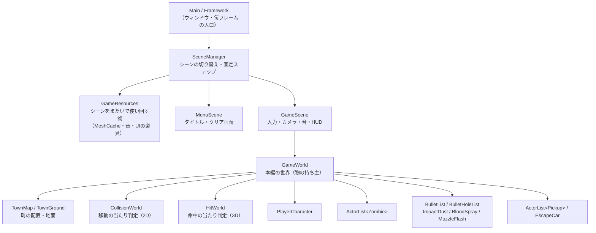
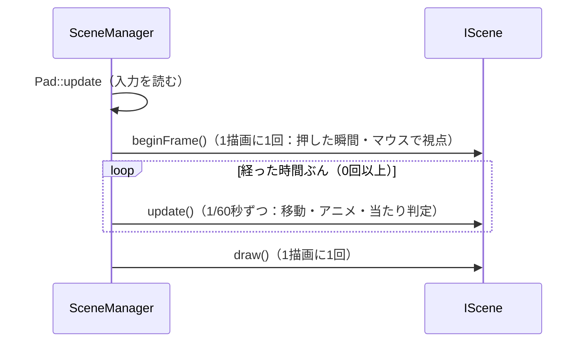
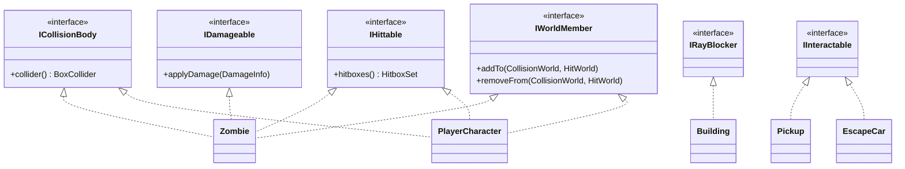
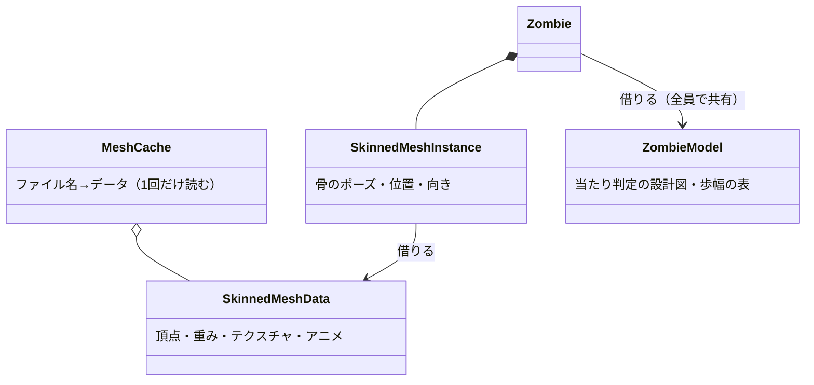
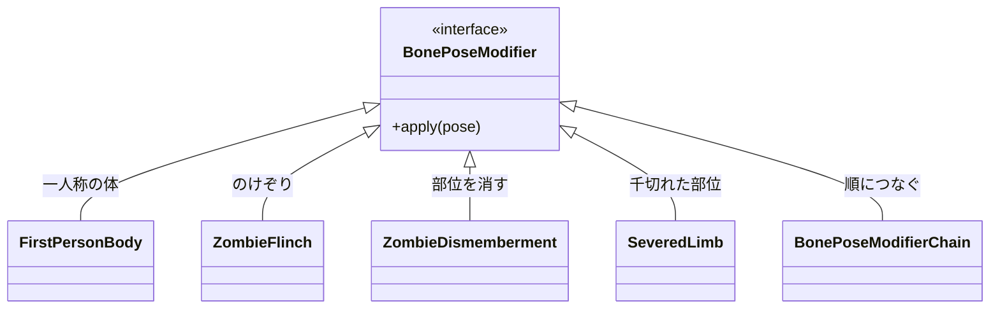
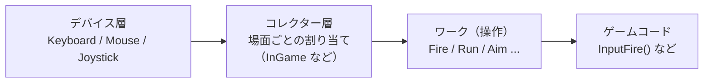
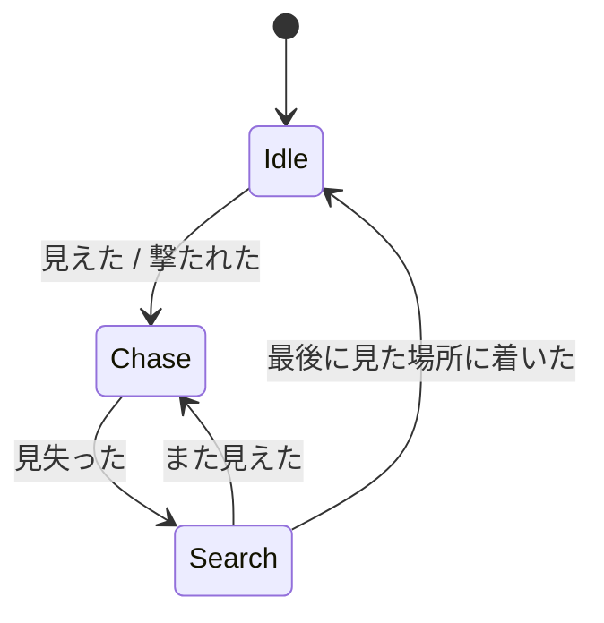

# ZombiFPS 技術まとめ（ポートフォリオ用）

最終更新：2026/10/19

> **この資料の使い方**
> - 自分用の「何を作ったか・なぜそうしたか」の整理ノート。面接やポートフォリオ資料の元ネタにする。
> - 1〜2章で全体像 → 3章でクラス設計 → 4章でアルゴリズム → 5章でアピールの仕方、の順に読む。
> - 図（```mermaid の部分）は GitHub か、VS Code に拡張機能「Markdown Preview Mermaid Support」を入れてプレビュー（Ctrl+Shift+V）すると絵で見られる。
> - 進捗や TODO は今まで通り `main.txt` が正。ここは「説明のしかた」をまとめる場所。

---

## 1. 作品概要

| 項目 | 内容 |
|---|---|
| タイトル（仮） | ZombiFPS ―「爽快さを追求したタルコフ」 |
| ジャンル | PvE ゾンビシューター FPS |
| ゲームの流れ | 町に置かれたガソリン3個を1つずつ車へ運び、町から脱出する |
| 言語・API | C++ / DirectX11 / HLSL |
| 土台 | GameLib（描画・数学・ファイル・入力の基盤ライブラリ）＋ miniaudio（音） |
| 開発期間 | 2026/05/30 〜（FPS としての本格開発は 2026/09 〜） |
| 規模 | ゲーム側（GameSrc）だけで 230 ファイル・約 13,900 行、シェーダ 7 本、自作ツール（Python 8 本＋C++ の音声合成ツール） |
| 素材 | キャラ・アニメは Mixamo。弾痕・血・砂ぼこり・マズルフラッシュの絵、足音などの音は自作ツールで生成 |

### GameLib（土台のライブラリ）のどこが自分の物か

面接では「このライブラリは自分で作ったの？」と必ず聞かれる。自分で書いた所と、元からあった所を分けて言えるようにしておく。
git の履歴から分かるのは次の通り（最初のコミット 2026/05/30 の時点で、GameLib は既に DirectX11 で動いていた）。

| 区分 | 中身 | 根拠（コミット） |
|---|---|---|
| 自分で追加 | 入力の3層構造（InputBuilder・InputConfig・InputCollector・InputDeviceCentor など。約1,900行） | 06/26「inputを三層構造にした」、07/30 |
| 自分で追加 | 描画の基盤：Shader・ConstantBuffer・RenderTarget・DepthTarget・VertexFormat（約1,000行） | 10/05「描画基盤の変更」 |
| 自分で追加 | ノーマルマップのシェーダ、GPU スキニング用の頂点（骨の番号・重み） | 09/21「ノーマルマップ追加」、10/05「GPU スキニング」 |
| 自分で追加 | miniaudio の組み込み | 10/01「音追加」 |
| 元からあった | 数学（Vector・Matrix）、コンテナ（Array・HashMap など）、ファイル読み書き、PseudoXml、スレッド、DirectX11 の描画の土台 | 最初のコミットに既にある |

> **自分で埋める**：最初のコミットより前のこと（GameLib を何から持ってきたか ― 本・授業・先輩など。DirectX11 化は自分でしたのか、元からだったのか）。git には残っていないので、自分の記憶で書く。
> **面接での言い方の例**：「数学やファイル読み込みなどの土台は既存のライブラリ（◯◯）を使い、入力の仕組みと描画の基盤（シェーダ・描画先）は自分で足しました。ゲーム側（GameSrc の約1.4万行）は全部自分で書いています」

### できていること（2026/10/19 時点）
- タイトル → 本編 → クリア の一周が遊べる
- 一人称の体が見える FPS（背骨の曲げ・ADS・反動・頭を消す）
- フルオート射撃、弾痕、着弾の砂ぼこり、マズルフラッシュ（点光源）、ブルーム
- ゾンビ：部位ごとの体力・ダメージ、のけぞり、よろけ、部位欠損（千切れて飛ぶ）、死亡 → 沈んで消える
- ゾンビ AI（気付く → 追う → 見失ったら最後に見た場所へ）
- 碁盤の目の町の自動生成、ガソリンのランダム配置、インタラクト（E）、インベントリ、HUD
- 3D 音声（足音は床の材質で変わる）、デバッグ表示（F1/F2/F3/F9）

---

## 2. 全体の構成



**ポイント**：「世界（GameWorld）」は入力・カメラ・音・HUD を知らない。シーンが世界を読んで動かす。
→ 世界のロジックだけを切り離して考えられ、テストや作り直しがしやすい。

### フォルダ（GameSrc）の分け方
| フォルダ | 役割 |
|---|---|
| Core | ゲームループの時計（FixedStepClock）、入力（Pad） |
| Scene | シーン管理、タイトル、本編、デバッグ表示 |
| World | 途中で増減する物の持ち主（ActorList） |
| Collision | 移動の当たり判定（SAT・掃引・滑る移動） |
| Hit | 命中の当たり判定（部位の箱・三角形） |
| Player / Weapon | 自キャラ、一人称の体、構え、連射、反動 |
| Zombie | ゾンビ本体、AI、体力、のけぞり、部位欠損 |
| Render | メッシュ、スキニング、カリング、ブルーム、板ポリの一括描画 |
| Effect | 血しぶき、砂ぼこり、マズルフラッシュ |
| Audio | 音の窓口、足音、環境音 |
| Map / Interaction / UI | 町、拾う・使う、画面の部品 |

---

## 3. クラス設計

### 3-1. ゲームループ：固定ステップ（FixedStepClock + IScene）



- **何をしている**：ゲームの更新は 1/60 秒（1ティック）ずつ、描画はモニターの速さで呼ぶ。経った時間を貯めて、ティック何回分かを数える。
- **工夫点**
  - 「1描画に1回でよい処理（押した瞬間の入力・マウスの視点回転）」を `beginFrame` に分けた。update が 0 回や 2 回のフレームでも、入力が消えたり2倍回ったりしない。
  - 処理が重くて追いつけないときは、上限（kMaxTicksPerFrame）を超えた分を捨てる（スパイラル・オブ・デス対策）。
- **面接での言い方**：「フレームレートに依存しない挙動にするため固定ステップにし、入力の取りこぼしが起きないよう処理を 3 つの段階に分けました」

### 3-2. シーン管理：切り替えは「予約」して後で行う（SceneManager）

- シーン一覧は `enum SceneId` の1か所に集める。
- ボタンを押した瞬間に切り替えると、**実行中のシーン自身が関数の途中で消えてしまう**。
  → `requestChange()` で予約だけして、`draw` の後に切り替える。
- 重い物（メッシュ・音）は `GameResources` が持ち、シーンを作り直しても読み直さない（Retry が速い）。

### 3-3. 物の寿命を設計で守る（GameWorld / ActorList / IWorldMember）

ゲームでよくあるクラッシュ原因は「消えた物を誰かが指している（ダングリングポインタ）」。これを**ルールで起きないようにした**。

| ルール | 実装 |
|---|---|
| 持ち主は1人 | `std::unique_ptr` で持つのは持ち主だけ。他は「借りるだけ」の生ポインタ |
| 消すのはティックの最後だけ | `ActorList::destroyLater()` で印を付け、`flush()` でまとめて消す（遅延削除） |
| 名簿への登録・解除は1か所 | `IWorldMember::addTo / removeFrom`。物の側が「どの名簿に何として載るか」を知っている |
| 壊れる順番も設計 | 名簿（CollisionWorld・HitWorld）を物より**先に宣言**＝物より**後に破棄**される |

```cpp
// ActorList の使い方（イメージ）
Zombie* z = mZombies.spawn( std::make_unique< Zombie >( ... ) ); // 持って、名簿へ載せる
mZombies.destroyLater( z );   // 印だけ付ける（update の途中でも安全）
mZombies.flush();             // ティックの最後に、名簿から外して消す
```

- **面接での言い方**：「消えた物を指すバグを“気を付ける”ではなく“構造で起きない”ようにしました。削除はティックの最後に限定し、名簿の登録解除も1か所に集めています」
- 2026-10-25 に ComponentSystem（Unity の GameObject＋Component と同じ考え方）へ置き換えた。`spawn / destroyLater / flush / find` の約束はそのまま `GameObjectWorld` が引き継いでいる。
  - 物（`GameObject`）は種類（タグ）と部品（`Component`）を持つだけで、振る舞いは部品（`Zombie`・`Pickup`）が持つ。
  - 更新は全部の部品へ自動で呼ばず、`GameWorld` が `forEach< Zombie >` のように種類ごとに決まった順で呼ぶ（順番がコードに見える）。
  - 部品の種類は自前の番号（RTTI を使わない）。種類ごとの並びも持つので、`forEach` は全部の物をたどらない。

```cpp
// GameObjectWorld の使い方（イメージ）
Zombie* z = mObjects.spawn( GameObjectTag::Zombie, std::make_unique< Zombie >( ... ) ); // 部品を付けた物を持ち、名簿へ載せる
mObjects.forEach< Zombie >( [ & ]( Zombie& zombie ) { zombie.update( ... ); } );       // 決まった順に種類ごとに呼ぶ
mObjects.destroyLater( z->gameObject() ); // 印だけ
mObjects.flush();                         // ティックの最後に、名簿から外して消す
```

### 3-4. インターフェースで役割を分ける

1つのクラスに全部を書かず、「何ができるか」をインターフェースで表している。



| インターフェース | 意味 | 使う側 |
|---|---|---|
| ICollisionBody | 移動を止める体（真上から見た長方形） | CollisionWorld |
| IHittable | 部位ごとに弾が当たる体 | HitWorld |
| IDamageable | ダメージを受けられる | GameWorld |
| IRayBlocker | 弾・視線を止める物（建物・地面・車） | HitWorld |
| IWorldMember | 名簿に自分を載せられる | ActorList |
| IInteractable | E キーで使える物 | Interactor |

- **工夫点**：当たり判定の名簿は「相手が何か（ゾンビか建物か）」を知らない。種類を増やしても名簿のコードは変わらない（開放閉鎖の原則）。
- `Interactor` は「当たった物が使える物か」を `std::function` の resolver で外から教えてもらう → Interactor はゲームの物の種類を知らずに済む。

### 3-5. 「設計図」と「1体ぶん」を分ける（Flyweight）

ゾンビを30体出しても重くならないよう、**全員で同じ物は1つだけ持つ**。



| 共有する（設計図） | 1体ごと |
|---|---|
| SkinnedMeshData（頂点・アニメ） | SkinnedMeshInstance（ポーズ） |
| HitboxLayout（どの骨にどんな箱） | HitboxSet（今の箱の位置） |
| ZombieStride（歩幅の表）・ZombieSeverLayout（切り方） | ZombieHealth・ZombieFlinch・ZombieDismemberment |
| TextureCache（同じ画像は1枚） | — |

### 3-6. アニメの上からポーズを書き換える差し込み口（BonePoseModifier）

`SkinnedMeshInstance` は「アニメの再生とクロスフェード」だけを知っている。ゲームの都合（視点で背骨を曲げる、部位を消す…）は **BonePoseModifier の派生クラス**に任せる（Strategy パターン。複数つなぐときは BonePoseModifierChain）。



- **工夫点**：書き換えるのは「見せるポーズ」の写しだけ。アニメのポーズ本体に書き換えが残ると、クロスフェードの混ぜ元に入り込んで**二重に掛かる**ため、分けて持っている。
- 当たり判定は書き換え**前**のポーズで取る（一人称で頭を潰した見た目ではなく、本来の体の位置で当てる）。

### 3-7. 入力の3層構造（デバイス → コレクター → ワーク）



- ゲームコードは `InputFire()` のように「何の操作か」だけを書く。キー・デバイスは一切知らない。
- キー割り当て（InputConfig）はファイルに保存・読み込みでき、キーコンフィグを後から作れる。
- 文字列（デバイス名・ワーク名）は InputBuilder.cpp の1か所だけで管理。

### 3-8. 音：外部ライブラリを隠す（AudioEngine、pImpl）

- `miniaudio.h` を読むのは AudioEngine.cpp だけ（pImpl）。ゲーム側は `SoundId` と位置を渡すだけ。
- バス（効果音 / 環境音）に分け、後で音量設定・ダッキングにつなげられる。
- 3D 音声（向きで左右・距離で減衰）、ドップラー、同じ音の別テイクと音程の揺らぎで「機械的に聞こえない」ようにしている。

### 3-9. UI

- `UiCanvas` が部品を持ち、マウス・キーの両方で選択／決定できる。
- 位置は「基準（左端・中央）からのずれ」で持つ（UiAnchor）。ウィンドウの縦横比が変わっても中央の物がずれない。
- `if constexpr` と `static_assert` で、選べる部品だけを自動で選択リストへ入れる（型で間違いを防ぐ）。

---

## 4. アルゴリズム

### 4-1. 移動の当たり判定：分離軸判定（SAT）＋掃引 ＋ 滑る移動
**ファイル**：`Collision/SweepMath.cpp`、`Collision/CharacterMover.cpp`

- **何をしている**：キャラを真上から見た「回転した長方形」として扱い、動かしたときに**一番早く当たる時刻**と面の向きを求める。
- **手法**
  1. **SAT**：2つの形を、それぞれの辺の向き（軸）へ影として落とす。どれか1本でも影が離れていれば当たっていない。
  2. **掃引（スイープ）**：軸ごとに「影が重なり始める時刻・離れる時刻」を求め、全軸で重なる一番早い時刻が当たった瞬間。→ 速く動いてもすり抜けない。
  3. **Collide-and-Slide**：当たったら面の少し手前まで進み、残りの移動から面へ向かう成分を消して壁に沿って滑らせる（最大3回）。
- **工夫点**
  - 面の「ちょうど上」で止めると誤差で次の判定が壁の内側から始まるので、1mm 手前で止める（Unity の skinWidth と同じ考え）。
  - 入り隅（2枚の壁の角）では左右に振動するので、前の面に入り込む向きになったら止める。
  - めり込んでいたら一番浅い軸の向きへ押し出す（群れに囲まれた時のために最大3回）。
  - 長方形どうしも、建物の多角形のかけらも「影」にすれば同じ計算で解ける形にまとめた。
- **なぜ 2D？**：歩く移動は水平だけなので 2D で十分。軽くて安定する。高さ（歩道の段差）は別に地面へ聞いて合わせる。

### 4-2. 建物の形に沿った壁を作る（Sutherland–Hodgman 法）
**ファイル**：`Collision/MeshWallBuilder.cpp`

- 建物のメッシュの三角形を、**体の高さの範囲（0.3m〜1.8m）だけ切り取って**壁のかけらにする。
- 切り取りは多角形クリッピングの定番 Sutherland–Hodgman 法。
- **効果**：足元の歩道の板や頭より上の庇は移動をふさがず、へこんだ入口や斜めの壁はそのままの形で当たる。
- 同じ向きの辺の法線は1本にまとめて、SAT で調べる軸を減らしている。かけらは数が多いので、届かない範囲の物は先に箱で捨てる。

### 4-3. 弾の当たり判定：スラブ法 ＋ Möller–Trumbore 法
**ファイル**：`Hit/HitMath.cpp`、`Hit/HitboxSet.h`、`Weapon/Bullet.cpp`

| 相手 | 形 | 手法 |
|---|---|---|
| キャラの部位 | 骨に付いた回転した箱（OBB） | 線分を箱の空間へ移し、-1〜1 の立方体とスラブ法で判定 |
| 建物・車・地面 | 三角形 | Möller–Trumbore 法 |

- **スラブ法**：x・y・z の軸ごとに「入る時刻・出る時刻」を求めて重ねる。重なりが無くなったら外れ。入った軸から面の法線も分かる。
- **OBB を単位立方体で扱う**：箱を「-1〜1 の立方体を置く行列」で持ち、逆行列で線分を立方体の空間へ移す。どんな向き・大きさの箱でも同じ計算で済む。
- **法線の変換**：拡大の入った行列で法線を移すときは (M⁻¹)ᵀ を使う（ただの M だと法線が曲がる）。
- **Möller–Trumbore**：三角形の中の点（u, v）と線分上の点（t）を連立で解く。弾痕を貼る向き・跳弾に使うため、法線は弾が来た側へ向ける。
- **弾は毎ティック「線分」で判定**：弾速 830m/秒（7.62×51mm NATO の初速）＝1ティック約 14m 進むが、通り道全体を線分で調べるのですり抜けない。

### 4-4. 部位の箱を頂点から自動で作る（主成分分析）
**ファイル**：`Math/BoxFitter.h`、`Hit/HitboxLayout.cpp`

- 部位ごとの頂点の集まりに沿った向きの箱を求める。
  1. 長い辺：関節を結ぶ向き（無ければ点の広がりが一番大きい向き＝主成分分析）
  2. 残りの2辺：長い辺に直交する面の中で、広がりが一番大きい向き
- 斜めに伸びた腕でも細長い箱になり、手で箱を置かなくてよい。
- 設計図（HitboxLayout）は全員で共有し、1体ごとに全頂点を調べ直さない。

### 4-5. ダメージ：全体の体力 ＋ 部位ごとの体力（テーブル駆動）
**ファイル**：`Zombie/ZombieHealth.cpp`

| 部位 | 部位の体力 | 倍率 | 0 で倒れる |
|---|---|---|---|
| 部位 | 部位の体力 | 倍率 | 1発のダメージ | 0 になるまで | 0 で倒れる |
|---|---|---|---|---|---|
| 頭 | 80 | 1.5 | 30 | 3発 | ○ |
| 胴 | 120 | 1.0 | 20 | 6発 | （全体と同じ） |
| 太もも | 60 | 0.75 | 15 | 4発 | × |
| 腕・すね | 40 | 0.5 | 10 | 4発 | × |

- 弾1発のダメージは 20（部位の倍率を掛ける前）。
- 全体（120）が 0、または「倒れる部位（頭）」が 0 で死亡。腕・脚が 0 になると千切れる（4-11）。
- 壊れた部位に当たっても全体の体力は減り続ける（腕を壊した後も、腕を撃ち続ければいつか倒れる）。
- 値は配列の表にまとめ、`static_assert` で「部位の数と表の数が同じ」をコンパイル時に確かめる（部位を増やして表を直し忘れるとビルドが通らない）。

### 4-6. ゾンビ AI：3つの状態 ＋ 負荷の分散
**ファイル**：`Zombie/ZombieChase.cpp`



- **見えているか**：ゾンビの目から自キャラの目へ線を引き、建物・車・地面に遮られていないか（50m 以内）。
- **工夫点**
  - **負荷の分散**：見通しの線は 0.2 秒に1回だけ。しかもゾンビごとに時刻をずらす（30体いても1ティックに数本）。
  - **ヒステリシス**：1.2m まで近づいたら止まり、1.5m 離れるまで歩き出さない。境目で「歩く・止まる」を繰り返さない。
  - 撃たれたら見えていなくても気付く（撃った場所が分かる）。
- 状態遷移（Zombie の State）は別に Alive → Downed → Falling → Corpse → Sinking を持ち、AI と生死を分けている。

### 4-7. 足が滑らない歩き（ルートモーションの代わり）
**ファイル**：`Zombie/ZombieStride.h`

- その場で歩くアニメ（根の骨が進まない）でも足が地面を滑らないように、**地面に着いている足先が後ろへ動いた長さだけ体を前へ進める**。
- ゾンビはびっこを引く歩き方（左右で歩幅も速さも違う）なので、一定の速さでは足が滑る。→ **フレームごとの表**を作った（1周 約1.0m）。
- 表は種類ごとに1つだけ作り、全員で共有。

### 4-8. アニメのクロスフェード（四元数の球面線形補間）
**ファイル**：`Render/SkinnedMesh/SkinnedMeshInstance.cpp`、`Math/MatrixBlend.cpp`

- 骨の行列を「移動・回転（四元数）・拡大」に分解し、回転は **slerp**、移動と拡大は線形補間して組み立て直す。
- **工夫点**
  - 混ぜ元は「切り替え直前に**実際に見えていた**ポーズ」の写し。前のアニメを動かし続ける方法だと、フェード中にもう一度切り替えたとき（歩き始めてすぐ止まる等）ポーズが飛ぶ。
  - 混ぜる割合は smoothstep（`t*t*(3-2t)`）。直線だと始まりと終わりで動きがカクッと変わる。
  - q と -q は同じ回転なので、内積が負なら裏返して近い回り方で補間。ほぼ同じ回転のときは正規化線形補間で代用（0割り対策）。
  - ポーズは「骨格の根から見た行列」で持つ。フェード中にキャラが移動・旋回しても、古いポーズが元の場所に取り残されない。

### 4-9. GPU スキニング
**ファイル**：`Render/SkinnedMesh/SkinningPipeline.cpp`、`Resource/Shader/SkinnedMesh.hlsl`

- 頂点の変形（4本の骨の重み付き合成）を CPU から GPU（頂点シェーダ）へ移した。
- 頂点は全キャラで共有し、骨の行列（3×4 行列 × 最大128本）だけを定数バッファで1体ごとに送る。
- 3×4 行列（float4 × 3行）にして、送るデータ量を 4×4 より 25% 減らしている。
- 1体ごとに持つのは骨のポーズだけで、**頂点の数に比例しない**。

### 4-10. 手続き的アニメーション（アニメ素材が無くても動きを作る）

#### 一人称の体（`Player/FirstPersonBody.h`）
タルコフのように「自分の体が見える FPS」を、Mixamo のアニメだけで作るための書き換え。

1. 視点の上下ぶん**背骨を3本に分けて**曲げる（1本だと腰から折れたように見える）
2. 右手首を曲げて銃の先を左手へ向ける（走りで左手が約8cm離れるのを直す）
3. 走るときは銃を胸元へ抱える
4. **手続き的 ADS**：銃のサイト線が目と視線に重なるよう、両腕をまとめて動かす（覗く専用アニメ不要）
5. 撃った反動で銃を後ろへ引き、銃口を跳ね上げる（目は動かさない＝照準はずれない）
6. 頭の骨を縮尺0にして潰す（カメラが頭の中にあるため、顔の裏が映るのを防ぐ）

#### のけぞり（`Zombie/ZombieFlinch.cpp`）
- 当たった部位の骨を、弾の向きへ曲げる。回す軸は「骨の向き × 押す向き」の外積。
- 毎ティック同じ割合を掛けて戻す（**指数減衰**。0.25秒で5%まで戻るよう係数を計算）。行き過ぎず滑らか。
- 上限 40 度で、フルオートで当て続けても曲がりすぎない。
- よろけ（gethit アニメ）は別に持ち、終わってから1秒は出さない（頭は必ず出す）。連射でよろけっぱなしにならない。

### 4-11. 部位欠損（骨を1点に潰す）
**ファイル**：`Zombie/ZombieDismemberment.h`、`Zombie/SeveredLimb.h`

- **体の側**：無くなった骨を全部、切り口の関節の**1点へ潰す**（縮尺0）。肩・肘のまわりの頂点は関節へすぼまるので、穴が空かない（蓋のメッシュを作らなくてよい）。
- **飛ぶ部位の側**：同じメッシュをもう1体描き、**逆に**千切れた部位以外の骨を潰す。部位ごとのメッシュを作らずに済む。
- 飛ぶ部位は切れた瞬間の姿勢で固め、弾の向きへ重力と回転で飛ばし、地面に着いたら止めて、10秒後に沈めて消す。
- 切れた部位の当たり判定（箱）も外す。脚を失ったら倒れたまま生きている（Downed）。

### 4-12. 描画の最適化
**ファイル**：`Render/ViewFrustum.cpp`、`Render/StaticMesh/StaticMeshMerger.h`、`Render/MeshCache.h`

| 手法 | 内容 |
|---|---|
| 視錐台カリング | 射影×ビュー行列の行を足し引きして6枚の面を取り出し（Gribb–Hartmann 法）、箱の「一番面の内側へ寄った隅」だけで判定（8隅全部を調べない） |
| バッチング | 道路の部品（何百枚）を、置いた後の形のまま種類ごとに1つのメッシュへ焼き込む → ドローコールを種類の数まで削減 |
| テクスチャの共有 | 同じ画像ファイルは1枚だけ読む（道路の部品9種が同じ絵） |
| 骨の番号引き | 毎フレームの骨の名前での文字列検索をやめ、番号で引く |
| 非同期読み込み | MeshCache がファイルを非同期で読み、終わった物から構築 |
| AI の分散 | 見通しの線を 0.2秒に1回・ゾンビごとにずらす |

- 次の計画（Optimization_Plan.txt）：建物のインスタンシング（192回 → 4回の見込み）、当たり判定の空間分割（ます分け）、LOD など。

### 4-13. ブルーム（明るい所をにじませる）
**ファイル**：`Render/Bloom.cpp`、`Resource/Shader/Bloom*.hlsl`

1. 描画先を RGBA16F（1 を超える明るさを持てる）にする
2. 明るさ 1 を超えた分だけを取り出す
3. 1/2 → 1/4 → 1/8 → 1/16 と縮めながらぼかす（4段）
4. 小さい段から順に、1つ大きい段へ加算して戻す

- マズルフラッシュの芯を「3倍の明るさ」で描き、光としてにじむようにしている（HDR → ブルームの流れ）。

### 4-14. エフェクトの一括描画（LitQuadBatch）
- 板ポリをためて1回で描く。2つのモード：
  - **LIT**：壁と同じライトで照らして半透明（弾痕・砂ぼこり）。弾痕は当たった面の法線で照らすので、壁と同じ明るさになる。
  - **GLOW**：ライト無しで加算（マズルフラッシュ）。加算なので描く順番を気にしなくてよい。
- 弾痕は同時16個まで、5秒から薄くして10秒で消す。付いた物が消えるときは一緒に消す。
- マズルフラッシュは「炎の形」ではなく「光」を目指し、光の芯＋**点光源**で周りの壁と自分の腕を一瞬照らす。

### 4-15. ランダム配置（部分的な Fisher–Yates シャッフル）
**ファイル**：`Map/SpawnPicker.cpp`

- 候補10か所から3か所を、重複なしで公平に選ぶ。全部を混ぜずに、選ぶ数だけ入れ替えて止める（O(選ぶ数)）。
- 種（seed）を渡すので、同じ種なら同じ配置を再現できる（デバッグしやすい）。

### 4-16. 町の自動生成（TownMap）
- 道の本数と部品の大きさから、道路キット9種類（直線・交差点・横断歩道・縁石・角…）の並びを組み立てる。
- 自キャラ・車・ガソリンの位置は**座標ではなく「道の番号」**で持つ → 町の形を変えても道の上に乗り続ける。
- 足元の部品の種類から床の材質を決め、足音を変える。

### 4-17. 音：足音のタイミングと自作の音声合成ツール
- **足音**（`Audio/FootstepEmitter.cpp`）：歩きアニメの位相（0〜1）が「足が着く位相（0 と 0.5）」を**またいだか**で鳴らす。1周して 0 に戻る場合も数える。動き出した最初のフレームは鳴らさない（前のアニメの位相と比べて誤って鳴るのを防ぐ）。
- **SoundGen**（`tools/SoundGen`）：足音・装備音・環境音を C++ で合成するツール。
  - 再現できる乱数（xorshift32）→ 作り直しても同じ音になる
  - RBJ の双2次バンドパスフィルタ、減衰する正弦波の束（床や金属の響き）、ノイズの粒（砂利・ガラス）、エコー、tanh のソフトサチュレーション、ループの継ぎ目消し
  - 足音 = かかとの低い衝撃 ＋ 靴底の擦れ ＋ 床の響き、のように部品を足して組み立てる

---

## 5. ゲーム会社にアピールできるポイント

優先順に並べた。面接・ポートフォリオでは上から話す。

### ① エンジンを使わず、FPS に必要な仕組みを一通り自分で作った
描画（スキニング・ポストプロセス）、当たり判定、AI、アニメ、音、UI、入力まで。
→ 「Unity/Unreal の中で何が起きているか」を理解している、と言える。

### ② 当たり判定を「目的ごとに」使い分けて、理由を説明できる
- 移動 → 2D の SAT＋掃引（軽い・安定・すり抜けない）
- 命中 → 3D の部位の箱（スラブ法）＋ 三角形（Möller–Trumbore）
- 建物 → メッシュを体の高さで切り取った壁
→ 「なぜその手法か」を言えるのが強い。

### ③ 「撃ち心地」へのこだわりを、手続き的アニメで実現した
ADS・反動・のけぞり・部位欠損を、専用のアニメ素材なしで作った。素材が足りない中で工夫した、という話はプランナー・エンジニア両方に響く。

### ④ 壊れにくい設計（寿命・所有権を構造で守る）
遅延削除（ActorList）、シーン切り替えの予約、宣言順＝破棄順、借用と所有の区別、`static_assert` によるコンパイル時チェック。
→ チーム開発で「バグを出しにくいコードが書ける人」と見てもらえる。

### ⑤ 増えても重くならない設計と最適化
Flyweight（設計図の共有）、GPU スキニング、視錐台カリング、バッチング、AI の負荷分散。最適化の計画書も作ってある。

### ⑥ 自分の制作パイプラインをツールで作った
Python：FBX → ゲーム用形式の変換、マテリアルのアトラス化、弾痕・血・砂ぼこり・マズルフラッシュの絵の生成。C++：音の合成ツール。
→ 「必要な道具を自分で作れる」はツールエンジニア・テクニカルアーティスト寄りのアピールにもなる。

### ⑦ 開発の進め方（仕様書 → 実装 → 週報）
機能ごとに仕様書（個別仕様/*.txt）を書いてから実装、毎週の報告書で進捗と課題を整理、デバッグ表示（F1 当たり判定・F2 物の透視・F3 体力・F9 ゾンビ出現）を用意。
→ 実際のゲーム会社の進め方に近い。

### さらに強くするために（やると効果が大きい順）
1. **数字で示す**：今は VSync が有効で計測の仕組みが無く、最適化の効果を数字で言えない。ImGui とフレーム時間の計測（DebugTools_Profiling_Plan.txt）を入れて「カリングで描画 ◯ms → ◯ms」「ゾンビ ◯体で ◯fps」を出すと説得力が一気に上がる。
2. **動画**：撃つ → のけぞる → 腕が千切れる → 倒れる、を 30秒〜1分の動画に。F1 の当たり判定表示を重ねたバージョンもあると技術が伝わる。
3. **GitHub で公開**（または提出用にコードを整理）し、README にこの資料の要約を載せる。

---

## 6. 面接で聞かれそうな質問と答え方のメモ

| 質問 | 答えの骨組み |
|---|---|
| なぜエンジンを使わなかった？ | 中の仕組みを理解したかった。当たり判定・スキニングなどを自分で書いたことで、エンジンを使うときも何が重いか分かるようになった |
| 移動の当たり判定を 2D にした理由は？ | 歩く移動は水平だけ。2D の方が軽く安定する。高さ（段差）は別に地面の高さを聞いて合わせている |
| 弾がすり抜けない理由は？ | 弾を点ではなく、1ティックの通り道の線分で判定しているから |
| 物を消すときに気を付けたことは？ | 更新の途中で消すと他が指したまま残る。印だけ付けてティックの最後にまとめて消す（ActorList） |
| ゾンビが増えたら重くならない？ | 設計図の共有・GPU スキニング・視線の分散で対策済み。次は当たり判定の総当たりを空間分割にする（課題として把握している） |
| クロスフェードで工夫したことは？ | 「見えていたポーズ」から混ぜるので、フェード中に切り替えてもポーズが飛ばない。slerp と smoothstep |
| 一番苦労したところは？ | （自分の言葉で）例：一人称の体。アニメのままだと手が銃から離れる・覗けない → 骨を手続き的に動かして解決 |
| 今の課題は？ | 当たり判定の総当たり（空間分割が必要）、AI が建物を回り込まない（NavMesh 予定）、ゾンビ同士の詰まり、効果を数字で測れていない |

---

## 7. 今の課題と次の一手（正直に言える形で）

| 課題 | 次の一手 |
|---|---|
| 地面の当たり判定が部品の総当たりで、ゾンビが増えるほど重い | ます分け（空間分割）→ 必要なら BVH |
| AI が建物を回り込まず、角で引っかかる | NavMesh（Recast）で経路探索 |
| ゾンビ同士が押し合って詰まる | 群れの分離（Separation）・経路の分散 |
| 最適化の効果を数字で言えない | ImGui＋計測（cpuWork / presentBlock）、Profile ビルド |
| ダメージ・演出の値が初期値 | 画面を見ながら調整。値をファイルから読めるようにする |

---

## 付録A. 用語のメモ

| 用語 | 一言で |
|---|---|
| ティック | ゲームの更新の1回（1/60秒） |
| SAT（分離軸判定） | 影を落として、どれかの軸で離れていれば当たっていない、という判定 |
| 掃引（スイープ） | 動かした間ずっと調べて、最初に当たる時刻を求めること |
| スラブ法 | 軸ごとの「入る・出る時刻」を重ねる、線分と箱の判定 |
| Möller–Trumbore 法 | 線分と三角形の交差を速く求める方法 |
| OBB | 回転した箱 |
| slerp | 四元数の球面線形補間。回転を一定の速さで混ぜる |
| スキニング | 骨の動きに合わせて頂点を変形すること |
| 視錐台カリング | カメラに映らない物を描かないこと |
| バッチング | 小さい物をまとめて1回で描くこと |
| ドローコール | GPU に「これを描いて」と頼む1回 |
| ブルーム | 明るい所が光ってにじむ表現 |
| Flyweight | 全員で同じ部分は1つだけ持つ設計 |
| pImpl | 中身を別クラスに隠して、ヘッダから外部ライブラリを見せない書き方 |

## 付録B. 説明するときに開くファイル早見表

| 話題 | ファイル |
|---|---|
| 寿命管理 | `GameSrc/include/GameSrc/World/ActorList.h` |
| 世界の全体 | `GameSrc/include/GameSrc/Scene/Game/GameWorld.h` |
| ゲームループ | `GameSrc/include/GameSrc/Scene/IScene.h`、`GameSrc/src/Core/FixedStepClock.cpp` |
| SAT・掃引 | `GameSrc/src/Collision/SweepMath.cpp` |
| 滑る移動 | `GameSrc/src/Collision/CharacterMover.cpp` |
| スラブ法・三角形 | `GameSrc/src/Hit/HitMath.cpp` |
| ゾンビ本体 | `GameSrc/include/GameSrc/Zombie/Zombie.h` |
| AI | `GameSrc/src/Zombie/ZombieChase.cpp` |
| クロスフェード | `GameSrc/src/Render/SkinnedMesh/SkinnedMeshInstance.cpp`、`GameSrc/src/Math/MatrixBlend.cpp` |
| 一人称の体 | `GameSrc/include/GameSrc/Player/FirstPersonBody.h` |
| 部位欠損 | `GameSrc/include/GameSrc/Zombie/ZombieDismemberment.h` |
| GPU スキニング | `Resource/Shader/SkinnedMesh.hlsl` |
| カリング | `GameSrc/src/Render/ViewFrustum.cpp` |
| ブルーム | `GameSrc/src/Render/Bloom.cpp` |
